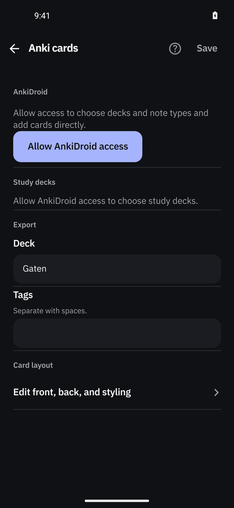
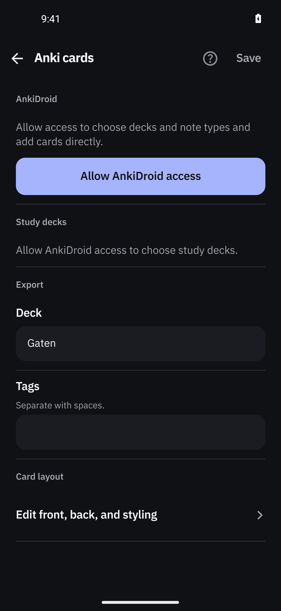
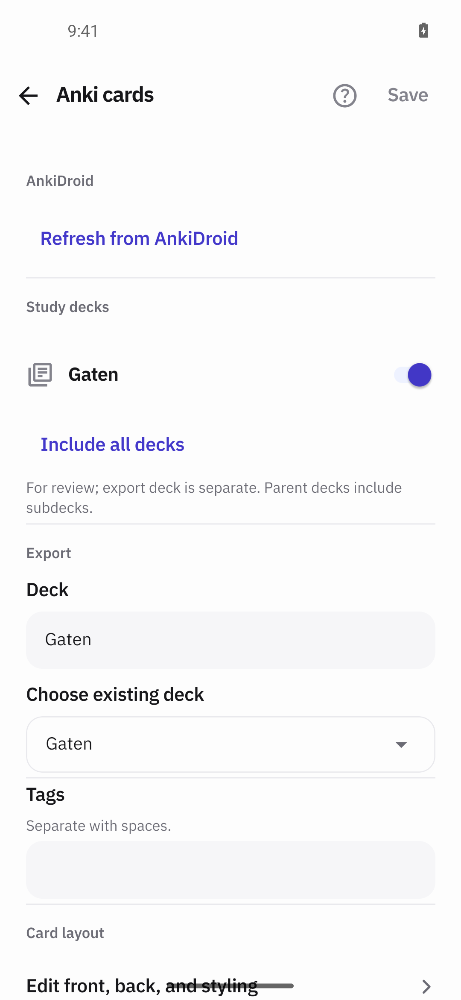
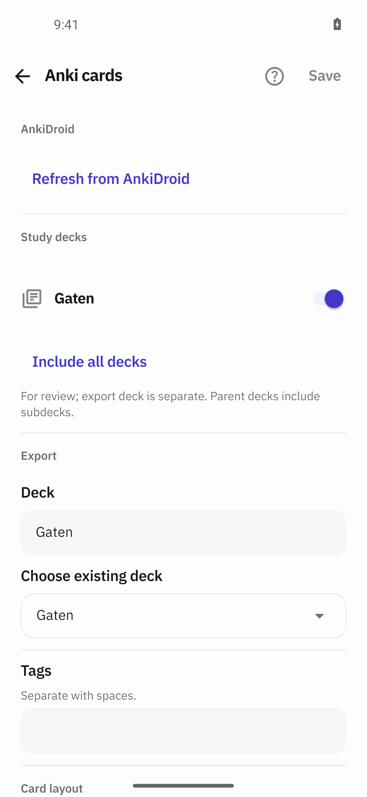

# Anki cards settings — layout aligned with the sibling settings pages

Proposed PR title: **fix(settings): align the Anki cards page with the settings rhythm**

Target: `dev`. This file is the prepared publication body; the change is uncommitted, and no commit or
push has been made yet.

> **Publication step:** commit `src/rn/ui/settings/AnkiSettingsScreen.tsx` and
> `docs/pr-evidence/anki-cards-settings-layout/`, then replace every `<COMMITTED_SHA>` below with that
> commit's SHA so the inline images resolve to that revision's raw files.

## Changes

- The Anki cards settings page was the only settings page not matching its siblings' rhythm, and the
  only place in the app with a filled **non**-full-width button. Five style-only edits in
  `AnkiSettingsScreen.tsx`, `+16 / −13`:
  - scroll content `paddingTop` `spacing.xl` → `spacing.s` and `paddingBottom` `spacing.l + insets.bottom`
    → `spacing.xl + insets.bottom`, matching `WaniKaniSettingsScreen`, the one other hand-rolled
    keyboard page;
  - every group body from `spacing.s` / `spacing.xs` → `spacing.m`, the app's 12 dp body rhythm;
  - **Allow AnkiDroid access** becomes the shared filled `Button` at `fullWidth` with a `spacing.m`
    gap above it, replacing the content-width, left-aligned block that sat flush against the paragraph.
    This is the same treatment the identical label already has on the review flow
    (`ReviewScreen.tsx:492` → `FilledAction` → `Button fullWidth`, `review-ui.tsx:571`);
  - the *Include all decks* action and the *Reading AnkiDroid… / Could not read AnkiDroid* lines gain a
    small top gap so stacked text is never flush.
- `ChoiceRow` (the **Choose existing deck** select) stays outlined and the text fields stay filled, as
  reviewed; the global `TextField` primitive is untouched, so there is no overlap with the open
  caret-colour work.
- No behaviour change: no state, handler, navigation, permission, persistence, theme or accessibility
  change, and no new token or component.
- `docs/design-language.md` records the refinement, as that companion asks of a UI change.

## Visual evidence

- **UI changed:** Yes.
- **Screenshots:** `needsPermission` and `ready`, light and dark, before → after. The before stills are
  the reported defects (content-width CTA flush to the paragraph, 24 dp top gap, 4 dp field padding).

The remaining four stills (`before/after-02` light `needsPermission`, `before/after-04` dark `ready`) are
in `docs/pr-evidence/anki-cards-settings-layout/`.

Measured on the light `needsPermission` pair, 2.75 px/dp:

| | before | after |
|---|---|---|
| Bar → first section label | 410 px (149.1 dp) | 366 px (133.1 dp) |
| CTA width / right inset | 216.0 dp / 154.2 dp | 348.0 dp / 22.2 dp |
| Paragraph → CTA gap | 2.9 dp | 14.9 dp |

- **Interaction, navigation or motion:** *No interaction, navigation or motion changed* — this is a
  static layout correction, so no recording is attached; the eight stills carry it.
- **Source:** Branch `fix/anki-cards-settings-layout` on base `b8a4b40` (`origin/dev`). Capture head
  diff hash `git diff | sha256sum` = `96edac65eb44811463c333694d8f0a8ed9c652547b37f4908e06d7a33d74217e`.
  Baseline APK `b78f000b6c96e64c67696cf05f18f03104e2781ff5d2d69dc3c314b7b5a27324` (pristine detached
  worktree of `b8a4b40`); after APK `255c4d24132726bbac176242dd301073f10f868445f15182ed8b0cb0e3d305d1`.
  Both `:app:assembleDebug -PreactNativeArchitectures=x86_64 --offline`. Device `emulator-5556` = AVD
  `Gaten_Lookup_Review` (resolved by name), Android 14 x86_64, 1080×2340 @ 440 dpi = 392 dp, font
  scale 1.0. Both phases rendered the **packaged** `assets/index.android.bundle` — logcat shows
  `isMetroRunning(): Async result = false` and `Loading JS Bundle` against a dead `10.0.2.2:8089`, with
  no cached dev bundle; a Metro server owned by another workspace on host `8081` was left untouched. The
  installed `base.apk` was hashed on device and matched the baseline APK exactly. **Not exercised:** the
  `notInstalled` state, 130 %/160 % text, narrow widths, landscape, other accents, TalkBack.
- **Assets:** `docs/pr-evidence/anki-cards-settings-layout/` — eight before/after stills and a README
  naming the device, builds, hashes, the bundle-selection reasoning, the restore table and the
  limitations.
- **Blocked capture:** No — all four state/theme pairs exist. One caveat is recorded rather than hidden:
  the after phase's on-device APK hash was not captured before those four stills, so only the baseline
  phase is hash-verified ahead of its captures; the after stills rest on the install audit trail plus
  the packaged-bundle logcat evidence.

## Verification

- **Steps and result:** `adb install -r` each APK by absolute path (never uninstall, never `pm clear`),
  confirmed data preservation by an identical `run-as com.gaten find . -type f` inventory and identical
  `shared_prefs` before and after each install, then opened Settings → **Anki cards** and captured the
  four states in both themes. The permission states came from `pm grant` / `pm revoke` of
  `com.ichi2.anki.permission.READ_WRITE_DATABASE`; the themes from the system night mode. Nothing was
  pressed but navigation — no Save, no switch toggle, no deck selection, no export, no grading.
- **Checks:** `./node_modules/.bin/tsc --noEmit -p tsconfig.json` exit 0; `:app:assembleDebug
  -PreactNativeArchitectures=x86_64 --offline` BUILD SUCCESSFUL for baseline and after; on-device
  `base.apk` sha256 matched the baseline APK exactly; `files/BridgelessReactNativeDevBundle.js` absent
  after every launch, proving nothing came from a dev server.
- **Restored:** AnkiDroid DB permission back to not-granted, system night mode back to dark,
  `accelerometer_rotation`/`user_rotation` to `1`/`0`, `font_scale` 1.0, `debug_http_host` back to
  `10.0.2.2:8081` in both preference files. The capture session was closed and the AVD released.
- **Not run:** no new automated tests (style-only change, and the repo adds none for layout), no
  instrumented/UI suite, no release build.

## Problems

- The after phase's on-device APK hash was not recorded at capture time (see *Blocked capture*); the
  audit trail pins it, but a re-shoot with the hash recorded first would make it exact.
- The `ready` stills carry a faint text-selection highlight under *Edit front, back, and styling* — a
  device selection artefact, not app UI.
- `files/BridgelessReactNativeDevBundle.js` (RN's dev-bundle cache, not app data) was deleted on the
  test device to force the packaged bundle; RN regenerates it on the next dev-server fetch.
