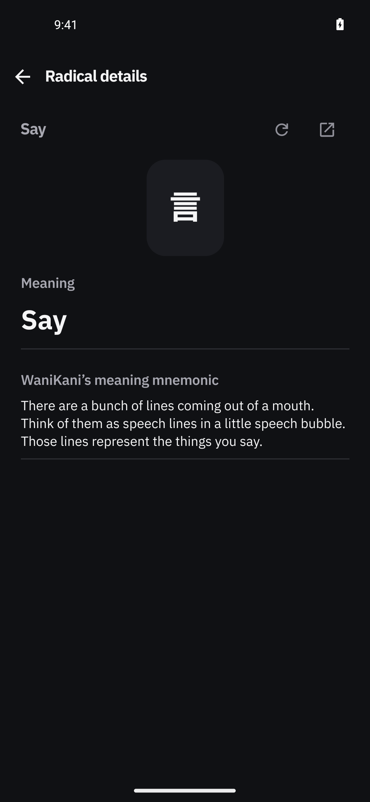
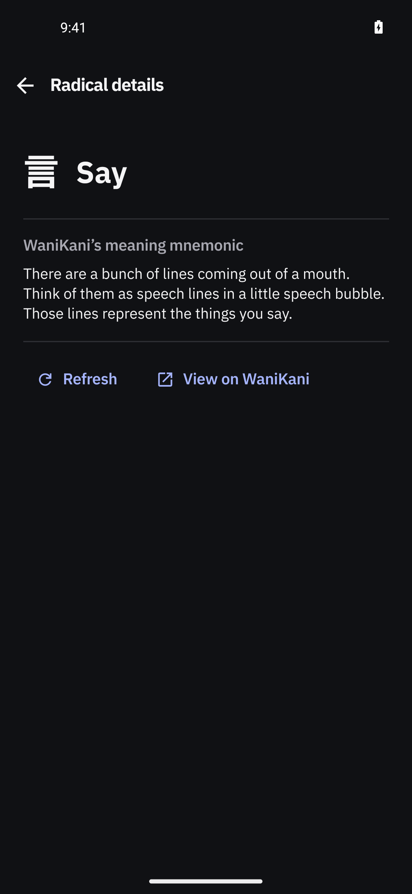
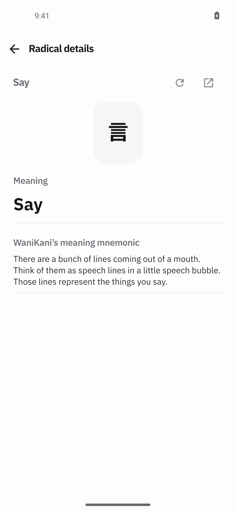
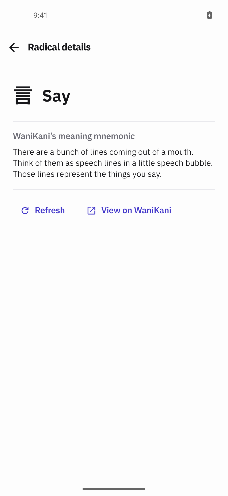
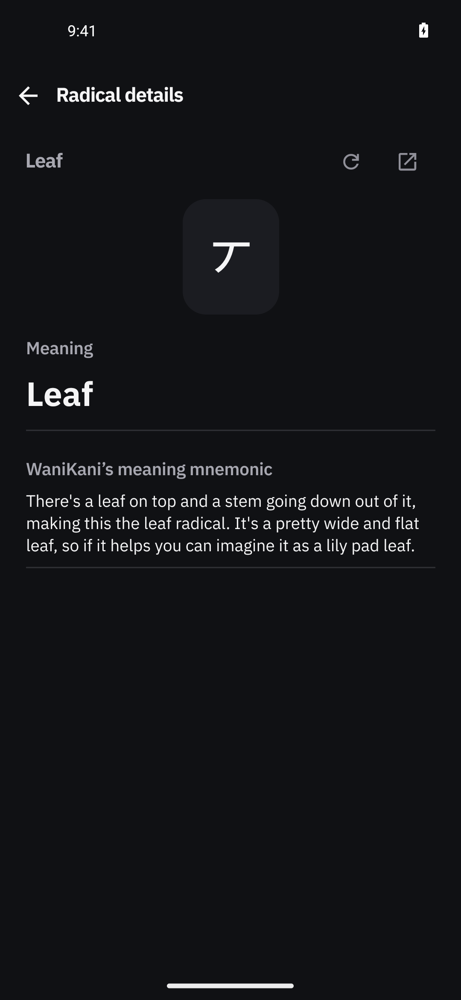
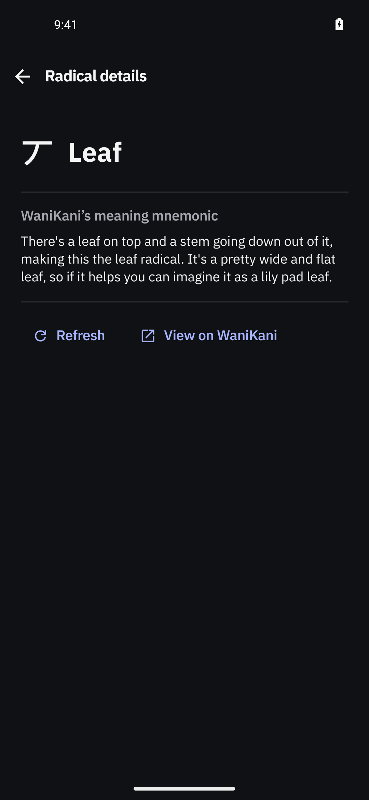
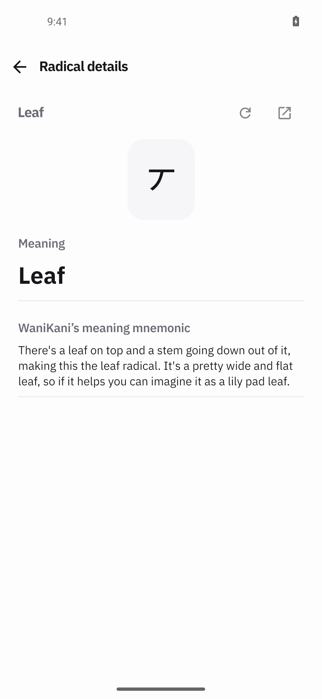
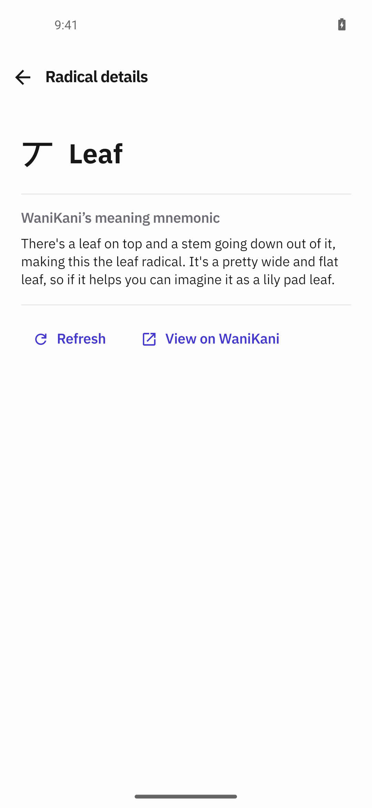

# Radical detail pages — unboxed drawing, one name, foot actions

Proposed PR title: **fix(wanikani): focus the radical detail page on its drawing**

Target: `dev`. This file is the prepared publication body; production code, evidence assets, commit
and push are unchanged by it. No commit or push has been made yet.

> **Publication step:** replace every `<COMMITTED_SHA>` below with the commit SHA that carries
> `docs/pr-evidence/radical-details-design/` on `Anurag-Raut/Gaten`, so the inline images resolve to
> that revision's raw files.

## Changes

- A radical's page now draws WaniKani's own SVG **directly on the page** — no tinted rounded panel
  behind it — with the radical's name as the page's primary text beside it instead of a second
  heading under the app bar. The meaning is stated once; alternates stay under it in muted small
  text. (`WaniKaniPanel.tsx`)
- The duplicate name row under the app bar is removed for radical pages, and its reload/open-in-new
  icon toolbar with it. The page's `Refresh` and `View on WaniKani` actions move to a flat foot row
  below the closing hairline; both keep their existing accessibility labels and behaviour.
- The mnemonic keeps its quiet label and the section-rule rhythm and now closes on that rule with
  the foot actions below it.
- Kanji pages, the loading skeleton, the no-entry/restricted/needs-token/auth/offline notices and the
  lookup overlay's back action are unchanged; `ReferenceScreen.tsx` only gains a clarifying comment
  and `docs/design-language.md` records the refinement.

## Visual evidence

- **UI changed:** Yes.
- **Screenshots:** Character radical `言` / “Say”, before → after, dark then light:

Second radical subject, WaniKani “Leaf” (丆), before → after:

- **Interaction, navigation or motion:** [Foot actions on the modified page](https://github.com/Anurag-Raut/Gaten/blob/<COMMITTED_SHA>/docs/pr-evidence/radical-details-design/after-05-radical-actions.mp4)
  (18.8 s, real app): tapping **Refresh** leaves the same subject and content settled, then
  **View on WaniKani** opens Chrome at `wanikani.com/radicals/say`; back returns to Gaten.
- **Source:** Branch `feat/radical-details-design` on `9350181` (`origin/dev` family). Before APK
  built from a pristine `git archive HEAD` copy: `app-x86_64-debug.apk` sha256
  `6842fee510f77bc603b07b04418f33658894553d82274ca7c3b34544934dd824`. After APK built from the
  modified working tree: sha256
  `90ed77f3cea602534757b2dd4a1c8b181c6a6cc91b882ec3e004149514209e89`. Capture head diff hash
  `git diff | sha256sum` = `10dc8bdd827d8341540afa95c4322efe3dc9c30691bf606a49dafecf2cc1c56a`. Device
  `emulator-5554`, AVD `Gaten_Lookup_Review`, Android 14 x86_64, 1080×2340 @ 440 dpi, font scale
  0.94, real connected WaniKani account; no review/lesson submitted. **Not exercised:** any WaniKani
  radical with a null character (every reachable component exposed a character; both captured
  subjects draw WaniKani's SVG, so the SVG-first branch is proven and the character-only/no-art
  fallbacks are code-reviewed only), the inline radical panel inside review's expanded kanji detail,
  320/340/430 dp, 130 %/160 % text, and TalkBack.
- **Assets:** `docs/pr-evidence/radical-details-design/` — eight before/after stills, the action
  recording, and the README with device, build and provenance, commands and limitations.
- **Blocked capture:** No — before/after stills, the light/dark pair and the action recording all
  exist. The character-null radical and the inline review panel are open coverage gaps, not blocks.

## Verification

- **Steps and result:** Installed each APK with `adb install -r` (never uninstall/`pm clear`), opened
  Home → Recently looked up `言葉` → kanji `言` → radical `言`, and 夏休み → kanji `夏` → radical `丆`,
  then captured dark and light. The after shots show the unboxed drawing with one name, no toolbar
  row and the foot actions; the before shots show the previous boxed drawing, name row and icon
  toolbar. On the after build the foot `Refresh` was tapped (page stable, same subject) and
  `View on WaniKani` opened the correct WaniKani page.
- **Checks:** `./node_modules/.bin/tsc --noEmit` exit 0; `:app:assembleDebug
  -PreactNativeArchitectures=x86_64 --max-workers=2` BUILD SUCCESSFUL for both before and after;
  `git diff --check` clean; the installed `base.apk` re-hashed to each APK's sha256 before capture.
  Device theme and font scale restored to the defaults (dark, 0.94).
- **Not run:** no new automated tests (UI-only change), no instrumented/UI suite, no release build.

## Problems

- No WaniKani radical with a null character was reachable through this account's dictionary
  component lists, so the drawing-when-no-character and no-art-at-all branches are verified by
  review only; the SVG-first path used by both captured subjects is device-proven.
- `Refresh` re-fetches with `refresh=true`, which is not observable in a still (identical cached
  content, no HTTP logging on this build); only the action being live and stable is captured.
