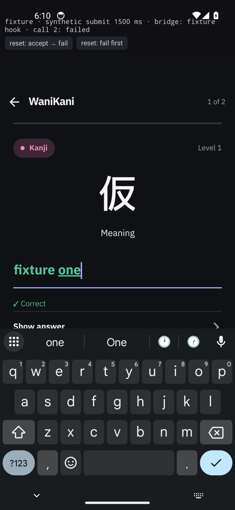
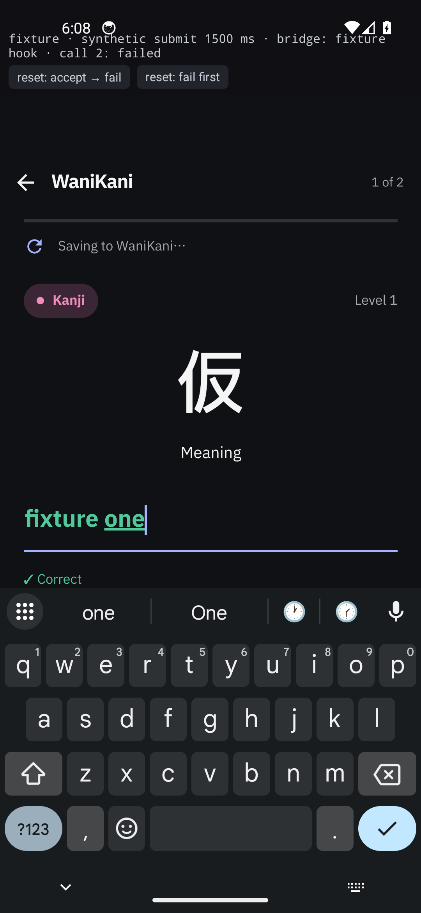
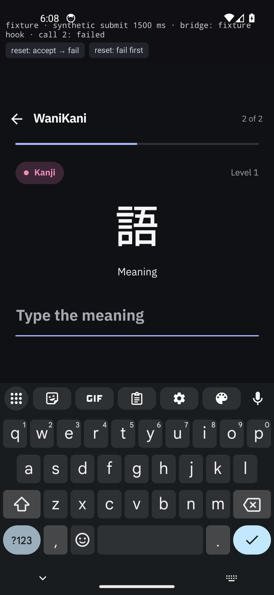
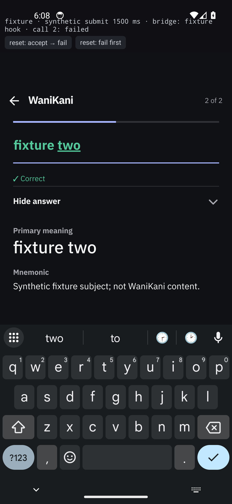
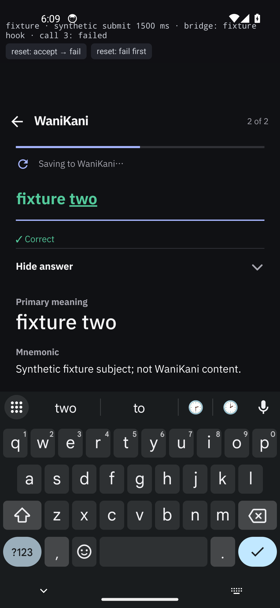
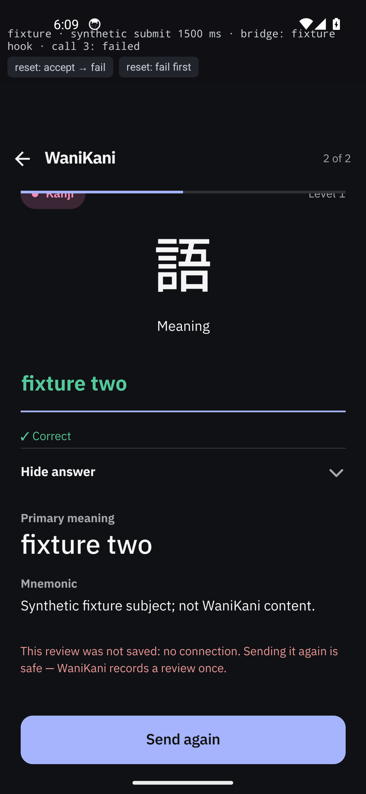

# WaniKani review — the save wait stays visible above the keyboard

| Item | Result |
|---|---|
| Reported problem | No loading indication after continuing a reviewed card, while the next prompt or a failure loads. |
| Real gap | The WaniKani review's only `Saving to WaniKani…` row lived in `ActionFooter`, which is deliberately left beneath the keyboard so the IME's Done key owns the action. With the keyboard up — the state a review is continued in — the row was rendered but covered. |
| Fix | The same `BusyRow` and message now sit in a fixed slot between the progress line and the scrolling card, inside `KeyboardAvoidingView` and outside the `ScrollView`. The footer copy is removed. No store, API, retry, timing or control behaviour changed. |
| Anki | Unchanged, deliberately. Its review has no IME, its pinned footer is visible, and `busy` is held from `Anki.grade` through `nextCard`, so `BusyRow "Saving to AnkiDroid…"` already covers the same wait. |
| Evidence | Real app on `emulator-5554`: before/after stills and two MP4s, including the expanded/scrolled details case. |

## Before and after

The only difference between the two fixture builds is `src/rn/ui/review/WaniKaniReview.tsx`; the
fixture, synthetic bridge and session are identical. Both stills are from the real installed app.

| Baseline (`HEAD` UI) | Fixed |
|---|---|
| No indicator at all: the only row is in the footer under the keyboard.  | `Saving to WaniKani…` is pinned above the keyboard.  |

The accepted save then advances to the next real prompt: .

The expanded/scrolled details case keeps the row fixed: .
The same run reaches the existing failure state after the synthetic `OFFLINE` result:
 → .

Motion:

- [accepted: typed answer → Done → pending → next prompt](after-accepted-next.mp4) (5.9 s)
- [failed: expanded/scrolled details → Done → pending → `submitFailed`](after-pending-failure.mp4) (3.5 s)

The fixture bar at the top names the synthetic bridge and the 1500 ms fixture delay. It is outside the
card and never covers the pending row. "call N" names the **next** scheduled call; call 1 is accepted
and call 2 is failed.

## Provenance

| Field | Value |
|---|---|
| Branch / base | `fix/review-next-card-loading`, base `d4977a6` (`d4977a6a35f7dd15da77d846debdff7e39d959ba`); evidence captured from the working tree later committed unchanged |
| Production fix source | `src/rn/ui/review/WaniKaniReview.tsx`, sha256 `f114addeb3a93c00e14ed6c910ce1825cb669ea7a1442088230a2f905cda5bea`; only UI file changed |
| Device | `emulator-5554`, AVD **Gaten Lookup Review**, Android 14 (`sdk_gphone64_x86_64`), 1080×2340, dark theme, Gboard (`com.google.android.inputmethod.latin`), software keyboard visible |
| Fixture after APK | `gaten-fixture-after-x86_64-debug.apk`, 205,487,064 B, sha256 `27fcc3db313d99def0b752539e01fe645001972fe925ea080c484675bb39811a`; bundle sha256 `521f7ba6661e825d649c9a79831fd2d594523e2b73c500d7bd97f8ccc7133370`; preserved in `/tmp/gaten-review-loading-evidence/` for this session, not committed |
| Fixture baseline APK | sha256 `7af61ba193688147f3d88409a7edbcc37581ce2d84edeed1671646e1fb853d37` (built and installed; artifact not retained) |
| Restored production APK | `app-x86_64-debug.apk`, 208,902,119 B, sha256 `7c40414b1467738b69950815d8e07a967ee00d13ae6747a1524255c9331a6261`; bundle sha256 `a5e848c8fa9145e2efdb2855ce4397346f4a284343d924c76a67cb5b8fd7ae2a` |
| Build | `flock /tmp/gaten-build.lock bash -lc 'ANDROID_HOME=/home/Qui/Android/Sdk ENTRY_FILE=docs/pr-evidence/review-next-card-loading/fixture/index.js ./gradlew :app:assembleDebug -PreactNativeArchitectures=x86_64 --console=plain'`; the restored production build omits `ENTRY_FILE` |
| Driver | `agent-device` 0.21.31 (`install`, `open --no-test-ime`, `press`, `type`, `scroll`, `screenshot`, `record`); taps on Gboard's visible Done key; session closed, emulator not shut down |
| Account | No WaniKani token and no network call. Fixture ids/meanings are never sent; no review, lesson or Anki schedule was changed. The restored app reports WaniKani **Not connected** and Anki **Permission needed**, as before. |

### What the synthetic edge does and does not prove

The production `reviewStore.submitWaniKani` runs: it sets `phase: "submitting"`, calls the bridge, then
uses the production `advanceWaniKani` path on acceptance and the production `submitFailed` path on
failure. The only synthetic part is the bridge result and its 1500 ms delay. These captures prove the
rendering and the store's real transitions; they do not prove a live WaniKani request, server
acceptance, or an account's schedule change. The temporary bridge hook is described in
`fixture/README.md` and `fixture/bridge-hook.patch`, and is absent from the committed source and the
restored production APK.

## Files

| File | Shows |
|---|---|
| `before-01-pending-next.png` | Baseline: pending save with the keyboard up and no visible indicator. |
| `after-01-pending-next.png` | Fixed: `Saving to WaniKani…` above the keyboard. |
| `after-02-next-prompt.png` | The accepted result advanced to the next real prompt (`2 of 2`, 語). |
| `after-03-details-scrolled.png` | `Show answer` expanded and the card scrolled before continuing. |
| `after-04-pending-failure.png` | The same row stays pinned while the details are scrolled and the save is pending. |
| `after-05-submit-failed.png` | The existing `submitFailed` state: `no connection`, `Send again`, keyboard dismissed. |
| `after-accepted-next.mp4` | Accepted run: typed answer → Done → pending → next prompt. |
| `after-pending-failure.mp4` | Failed run: expanded/scrolled details → Done → pending → failure. |
| `fixture/` | Reproducible fixture source, bridge hook patch, and reproduction notes. |

## Limits

- One emulator, portrait, dark theme, one fixture review. Not exercised: a live WaniKani submission,
  the retry (`Send again`), lessons, Anki, landscape, reduced motion, or a real account.
- The baseline artifact was installed and captured but not kept; its hash is from that build.
- The production APK was rebuilt and reinstalled after the fixture, so the emulator holds the ordinary
  app again. The device was not shut down.
- `tests/wanikani-hub.test.cjs` is red on the base: its in-VM require map cannot load the store's
  `./wanikani-romaji` import. The same 44-test baseline is documented on `origin/dev`; no test was
  added for this UI relocation.
