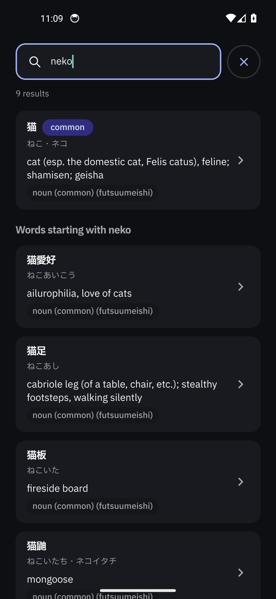
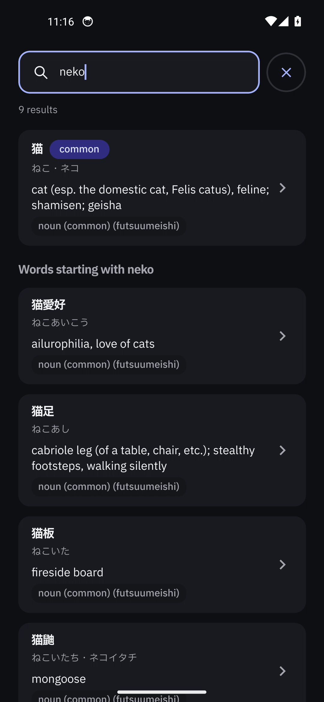
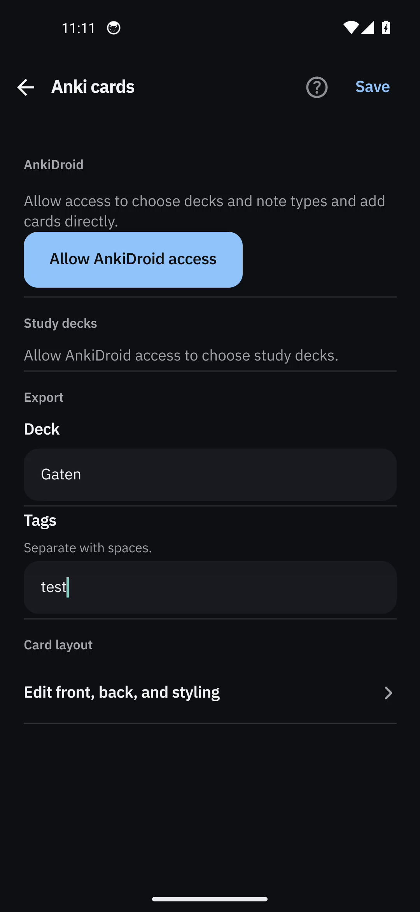
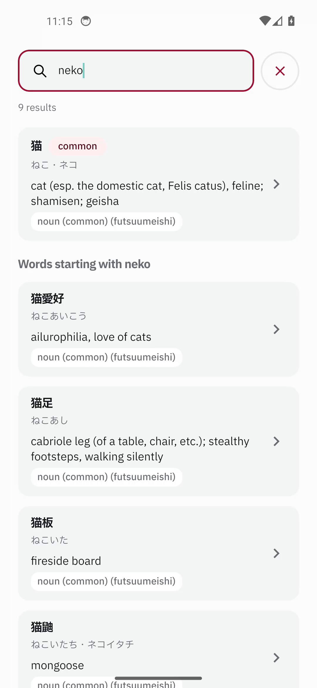
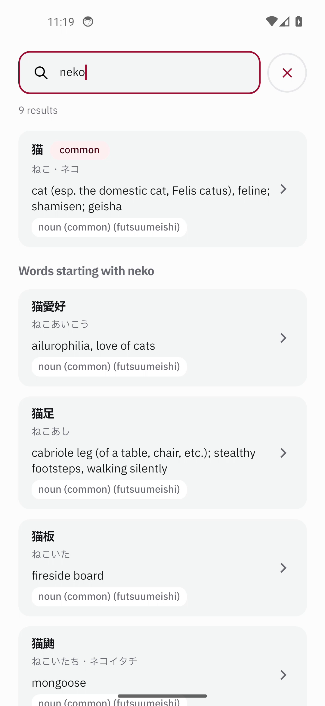

# Text input cursor accent — device evidence

## At a glance

| Item | Value |
| --- | --- |
| Change | Every shared text field now gives the caret the app accent through React Native's `cursorColor`. |
| Surfaces | `SearchField` (Home and lookup overlay), `TextField` (Settings and WaniKani connect), `AnswerInput` (WaniKani lessons and reviews). |
| Theme coverage | The colour comes from `ThemeProvider`'s resolved `colors.accent`, so light/dark and the reader's accent follow automatically. |
| Captures | Three before/after pairs: Home search in dark Indigo, the Anki tags `TextField` in dark Blue, and Home search in light Rose. |
| Result | The caret is the platform default teal before the change and the resolved accent after it. |
| Device | AVD `Gaten_Lookup_Review`, x86_64, Android 14 (API 34), 1080×2340. |
| Cleanup | Debug APK uninstalled, agent-device session closed, emulator shut down; no device claims left. |

## Scope

All three React Native text-input primitives set the Android caret colour:

```diff
 src/rn/ui/search/searchParts.tsx
+          cursorColor={colors.accent}

 src/rn/ui/settings/settings-components.tsx
+        cursorColor={props.cursorColor ?? colors.accent}

 src/rn/ui/review/review-ui.tsx
+      cursorColor={props.cursorColor ?? colors.accent}
```

There are no other `<TextInput>` render sites in `src/rn/ui`; these three primitives cover the Home
search box, the lookup sheet's search box, every Settings field, the WaniKani connect field, and the
WaniKani lesson/review answer fields. `cursorColor` is the Android caret API and the app's
`minSdk` is 29, so React Native's `ReactTextInputManager.setCursorColor` path applies.

`selectionColor` was deliberately left alone. The WaniKani answer fields already set it to the accent;
the other fields keep the framework's selection and handle treatment, which this task does not
change.

The colour is read from `useTheme().colors.accent`, which `ThemeProvider` resolves from the native
palette for the current mode and accent. No new colour constant or theme field was introduced.

## Before / after

| Pair | Screen and theme | Before | After |
| --- | --- | --- | --- |
| 1 | Home search, dark, Indigo | [`before-01-home-search-dark-indigo.png`](before-01-home-search-dark-indigo.png) | [`after-01-home-search-dark-indigo.png`](after-01-home-search-dark-indigo.png) |
| 2 | Anki tags `TextField`, dark, Blue | [`before-02-settings-dark-blue.png`](before-02-settings-dark-blue.png) | [`after-02-settings-dark-blue.png`](after-02-settings-dark-blue.png) |
| 3 | Home search, light, Rose | [`before-03-home-search-light-rose.png`](before-03-home-search-light-rose.png) | [`after-03-home-search-light-rose.png`](after-03-home-search-light-rose.png) |

### 1. Home search — dark, Indigo

| Before | After |
| --- | --- |
|  |  |

### 2. Anki tags `TextField` — dark, Blue

| Before | After |
| --- | --- |
|  |  |

### 3. Home search — light, Rose

| Before | After |
| --- | --- |
|  |  |

### Measured caret colour

The caret core was sampled from each PNG at the caret's vertical centre: `(283, 240)` for the Home
pairs and `(172, 1510)` for the Settings pair, in 1080×2340 captures.

| Pair | Before | After |
| --- | --- | --- |
| Home, dark Indigo | `#7ECAC2` (platform teal) | `#A3B2FA` (Indigo primary) |
| Settings, dark Blue | `#85C9BF` (platform teal) | `#91C2FA` (Blue primary) |
| Home, light Rose | `#81CBBF` (platform teal) | `#9D1136` (Rose primary) |

The small differences in the three before values are anti-aliasing at the sampled edge; all three
are the same framework teal family. The after value follows the accent chosen in Settings.

## Device, builds and method

| | |
| --- | --- |
| Device | `emulator-5554`, AVD `Gaten_Lookup_Review`, x86_64, Android 14 (API 34), 1080×2340 |
| Before APK | sha256 `623df4b9ab5d91a7dcd74a0330bf2c9670eca262e3581d4148c916cfd97d3cfa` (base `b8a4b40`) |
| Before JS bundle | sha256 `226d3201e1f0ad047146d2be3326d56ad35588e5af95bf36ec90efccd732e333` |
| After APK | sha256 `b51a92506facd47b2d0d8c5b7fbbd0a3a609ce931d00bbde87edfa56a35de59b` (this working tree) |
| After JS bundle | sha256 `2bbfcf646fc3f5f2387130a42e4675bdc1430ca22a11eaf9de4f36cbc57b8254` |
| Build | `ANDROID_HOME=$HOME/Android/Sdk ./gradlew :app:assembleDebug` |
| Capture | agent-device `record` at 10 fps after focusing and typing; the frame with a lit caret was kept |
| Text typed | Home: `neko`; Anki tags: `test` (discarded without saving) |

The APK swap reset Gaten's stored preferences, so each pair's theme (mode and accent) was
re-established through the app's own Appearance screen before capturing. The typing used the
agent-device headless test IME, so no software keyboard appears in the stills; the caret is the
evidence.

No review or lesson was started or submitted. The Anki settings change was discarded with the app's
own **Discard changes?** action.

## Steps

1. Booted only `Gaten_Lookup_Review`; no other emulator was running.
2. Installed the before APK, set the first theme through Settings → Appearance, focused Home search,
   typed `neko`, and recorded the caret. Repeated after changing to dark Blue and light Rose.
3. Installed the after APK, re-established the same three theme states, and repeated the same field,
   text and capture steps.
4. Uninstalled the debug APK, closed the agent-device session, shut the emulator down, and verified
   `adb devices` was empty, no emulator process remained, and no device claims were left.

## What was not exercised

- **Lookup overlay search.** It renders the same `SearchField` component, but the accessibility
  service was not bound in this session, so the overlay was not opened or captured.
- **WaniKani answer input.** WaniKani was not connected on this device and no account was used, so
  the `AnswerInput` surface is covered by source rather than a still.
- **Other accents.** Indigo, Blue and Rose in light/dark were captured; Violet, Teal, Green, White
  and Black were not.
- **Review, lesson and settings persistence.** No review or lesson was submitted, and the Anki tag
  edit was discarded.

## Offline validation

| Check | Result |
| --- | --- |
| `npx tsc --noEmit` | passed (no output) |
| Metro Android bundle | passed |
| `./gradlew :app:assembleDebug` | first full run `BUILD SUCCESSFUL in 2m 9s` (281 tasks); incremental rebuild `OK` |

The generated dictionary assets needed by `assembleDebug` were local, gitignored build inputs; no
tracked file changed.
