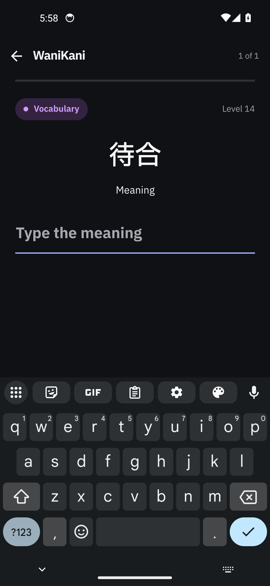
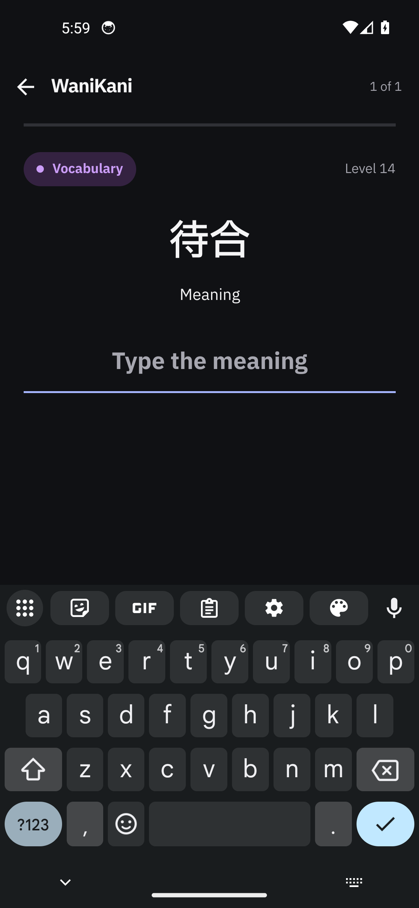
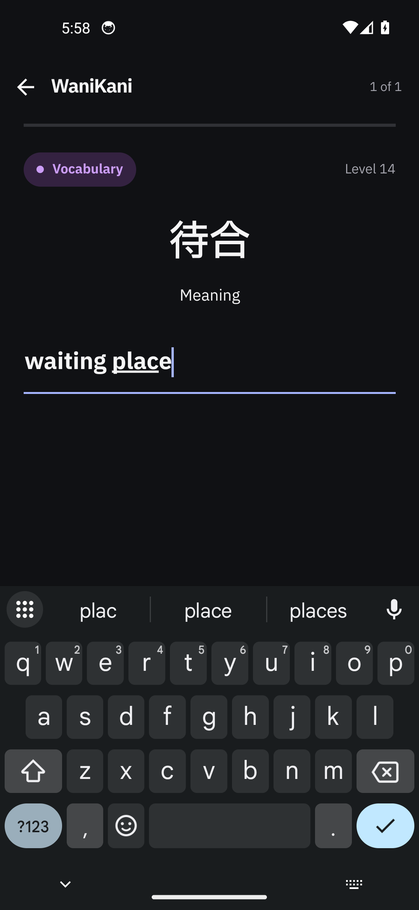
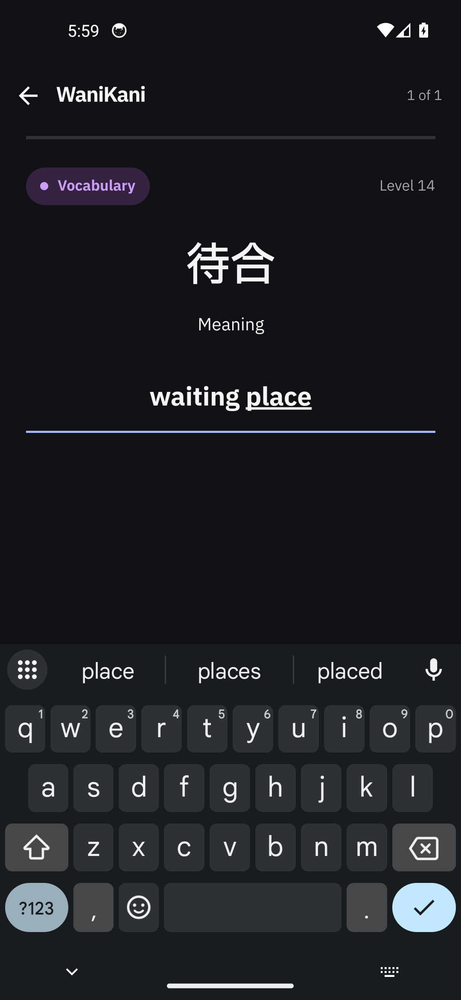
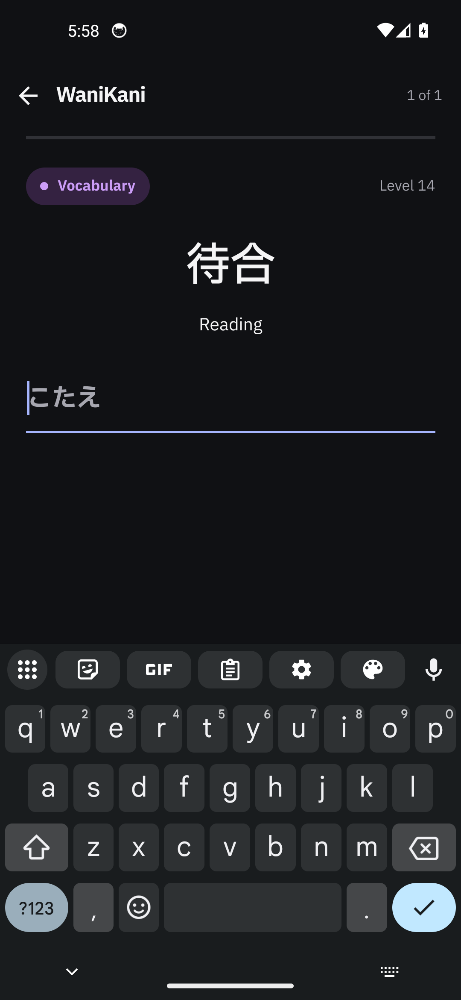
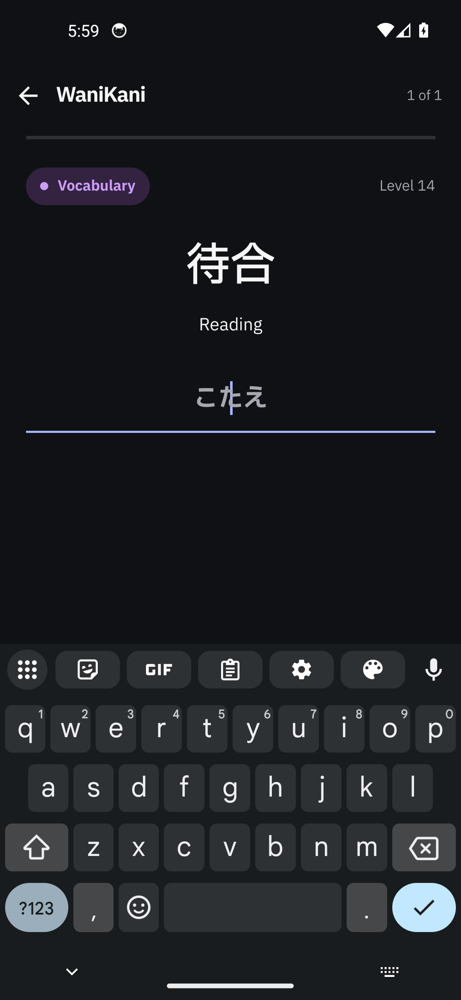
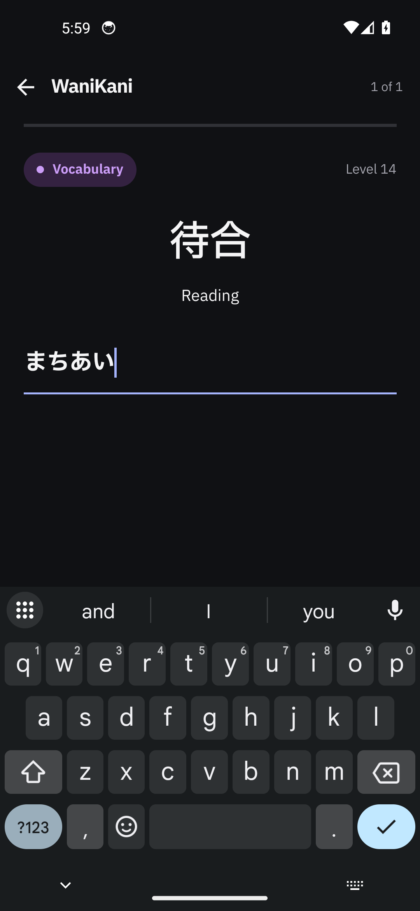
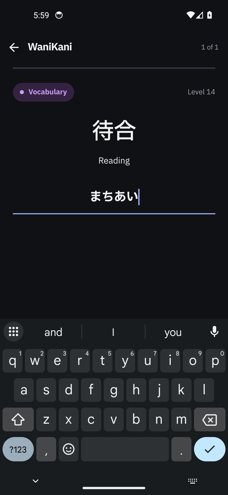

## Changes

The WaniKani review prompt's answer field now centres its placeholder and its typed text, so the field
sits on the same axis as the centred prompt above it. TickTick task:
https://ticktick.com/webapp/#p/inbox125722853/tasks/6aedc0832b7a1f64be9d91fb.

- **Cause.** The shared `AnswerInput` (`src/rn/ui/review/review-ui.tsx`) sets `textAlign: "left"` —
  right for a text field, and what the lesson quiz still wants. The review screen centres everything
  else in that column (subject badge, hero characters, Meaning/Reading pill), so the field was the one
  element still reading from the left edge.
- **Fix.** One property at the one call site that needs it: `style={[styles.answerText, {color: answerColor}]}` with `answerText: {textAlign: "center"}` in
  `src/rn/ui/review/WaniKaniReview.tsx`. `AnswerInput` applies a caller's `style` last, so the shared
  default is untouched and the lesson quiz does not move.
- **Preserved.** The stroke is `AnswerShake`'s own absolutely positioned, full-width line, so centring
  the text moves neither it, nor the verdict below it, nor the shake's translation. Colours, the 21 dp
  bold lettering, the field's height, autofocus, the caret and the keyboard behaviour are unchanged;
  retry, loading and submission logic are untouched.
- **No new tests.** A cosmetic alignment change; none added and none re-pinned.

## Visual evidence

- **UI changed:** Yes.
- **Screenshots:** Same device, same fixture subject, same frame. Left is the build with the fix
  reverted to `HEAD`, right the build with it.

  | Scene | Before | After |
  | --- | --- | --- |
  | Meaning, empty |  |  |
  | Meaning, `waiting place` |  |  |
  | Reading, empty |  |  |
  | Reading, `machiai` → `まちあい` |  |  |

  The report's own capture of the shipped app — `Type the meaning` at the field's left edge, on a real
  account — is [`00-report-screenshot.jpg`](https://raw.githubusercontent.com/Anurag-Raut/Gaten/0580c69b442a0bfc13a03d7600badc531fc2441a/docs/pr-evidence/wanikani-answer-center/00-report-screenshot.jpg);
  `fixture-harness-bar-probe.png` is the harness chrome only, not part of the comparison. The stills
  live in `docs/pr-evidence/wanikani-answer-center/` and are linked by commit-pinned raw URLs.
- **Interaction, navigation or motion:** Not applicable — a static alignment. The stills keep the real
  Gboard keyboard up, so the field's height and position are the ones a reader sees while typing.
- **Source:** Base `d4977a6` (`origin/dev`) plus one file, `WaniKaniReview.tsx` (3 lines added,
  1 changed), committed as `0580c69b442a0bfc13a03d7600badc531fc2441a`. The fixture builds and the stills were made
  from exactly that production source before it was committed, and nothing later on the branch touches
  production code. `emulator-5554`, AVD `Gaten_Lookup_Review` (Android 14, x86_64,
  1080 × 2340 @ 440 dpi, `font_scale` 1.0, system dark); built with the repo's own
  `:app:assembleDebug -PreactNativeArchitectures=x86_64`. Both fixture APK sha256s, their bundle hashes
  and the device hashes are in the [evidence README](https://github.com/Anurag-Raut/Gaten/tree/0580c69b442a0bfc13a03d7600badc531fc2441a/docs/pr-evidence/wanikani-answer-center). The fixed build's packaged bundle carries
  `answerText` where the base build's does not — a string-presence check that the change is in the
  build under test, not a byte-level diff of the two binaries. Not exercised: the queue read, the
  lesson quiz, judging/retry, submission, a real account.
- **Assets:** [the evidence directory](https://github.com/Anurag-Raut/Gaten/tree/0580c69b442a0bfc13a03d7600badc531fc2441a/docs/pr-evidence/wanikani-answer-center) — README with the full provenance table, method and
  hashes, the stills, `fixture/` and `build-fixture-apk.sh`. That fixture is how the stills exist at
  all: it mounts the production `WaniKaniReview` over one synthetic session, because the device holds
  no WaniKani token and a capture run must not be pointed at a real account.

## Verification

- **Steps and result:** Built the fixture twice (fix reverted / fix in place), installed each in place
  on `emulator-5554` with the on-device `base.apk` hash matched to the artifact, then drove the app with
  `agent-device`: screenshot the empty meaning prompt, type `waiting place`, screenshot, dismiss the
  keyboard, tap the harness to the reading prompt, tap the field, screenshot the empty reading prompt,
  type `machiai`, screenshot. Every PNG was read back and inspected; the plain production build was
  reinstalled afterwards and the session closed without shutting the emulator down.
- **Checks:** `npx tsc --noEmit -p tsconfig.json` — no errors. `node --test` over the six existing
  review suites (`wanikani-answer-feedback`, `wanikani-review-prompt-order`, `wanikani-review-default-tab`,
  `wanikani-romaji`, `wanikani-leave-confirm`, `meaning-match`) — 35 pass, 0 fail. Three Gradle builds
  — `BUILD SUCCESSFUL`. No unit test covers this change, and none is added: one style property, no
  logic.

## Problems

- The captures are **fixture evidence** (production screen, synthetic session), because the device holds
  no WaniKani account; they prove the rendering change only.
- **The lesson quiz keeps the left-aligned field.** The ticket and its screenshot are the review prompt,
  and the shared `AnswerInput` default is deliberately unchanged.
