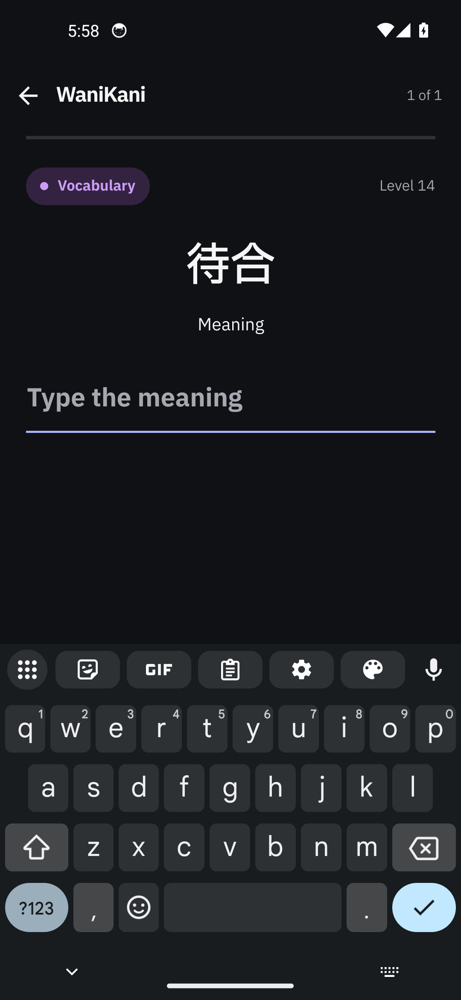
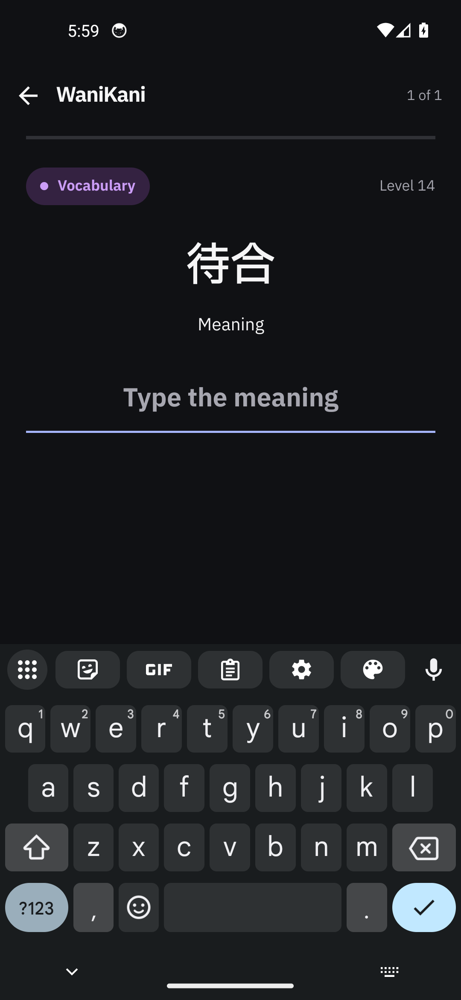
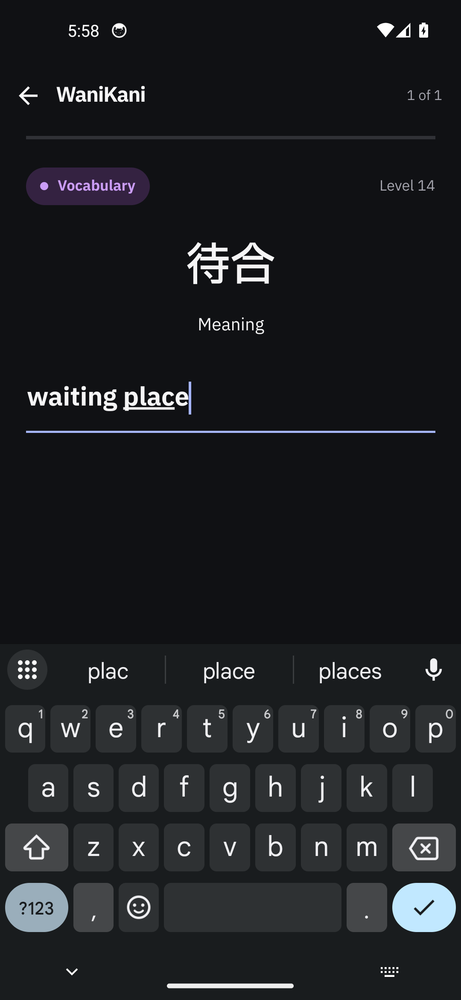
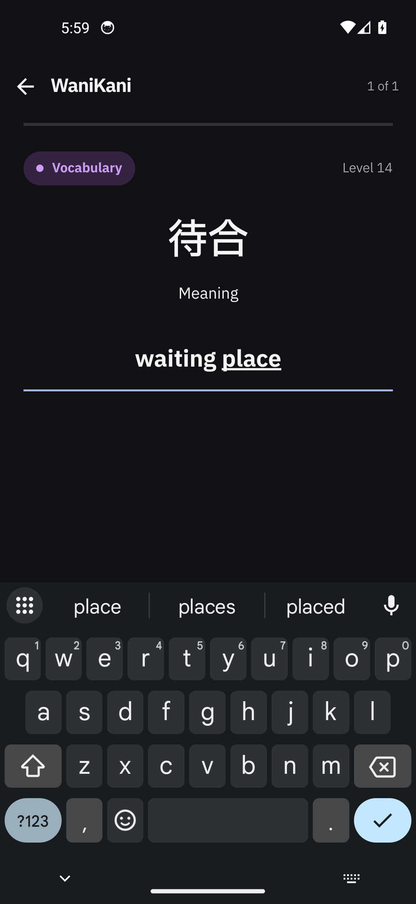
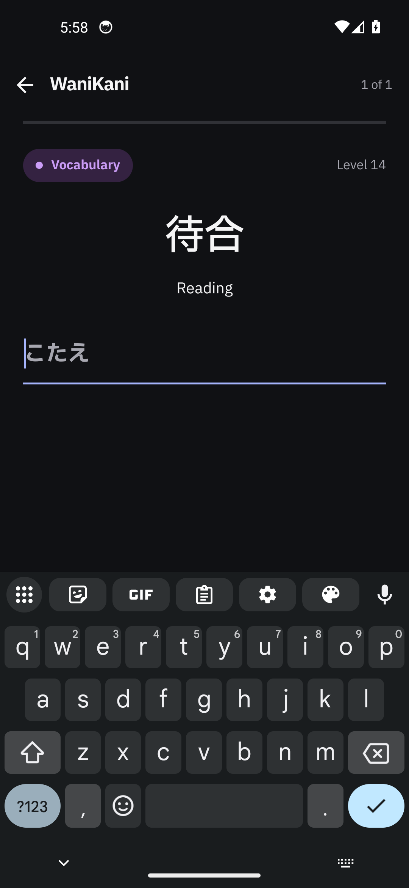
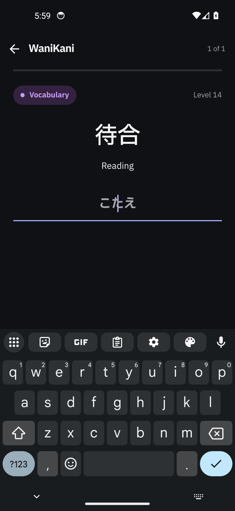
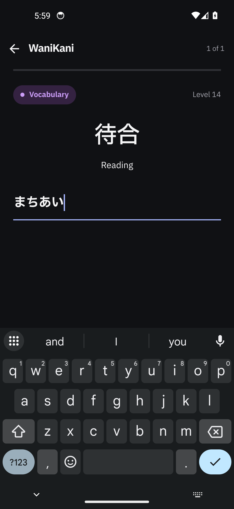
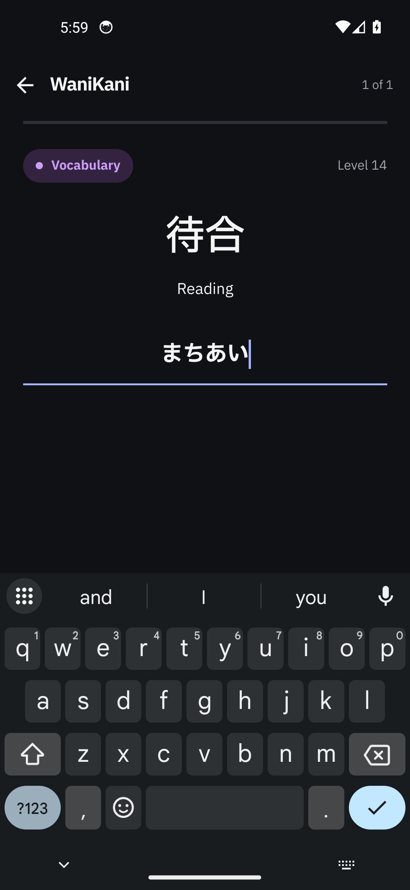

# WaniKani review answer alignment — device evidence

The WaniKani **review** prompt's answer field now centres what it shows — the placeholder and the
typed answer alike — under the centred prompt, instead of starting both at the field's left edge.

| | |
| --- | --- |
| TickTick task | https://ticktick.com/webapp/#p/inbox125722853/tasks/6aedc0832b7a1f64be9d91fb |
| Change | `src/rn/ui/review/WaniKaniReview.tsx`: the answer field gains `textAlign: "center"` at its own call site. |
| Shared input | `AnswerInput` (`src/rn/ui/review/review-ui.tsx`) keeps `textAlign: "left"`, so the lesson quiz and every other user of the shared field are untouched. |
| Preserved | The underline (`AnswerShake`'s own static stroke, still full width and still at the same y), the caret, the placeholder/accent/stroke colours, the 21 dp bold lettering, the field's height, autofocus and the keyboard behaviour. |
| Captures | Eight stills from one device and one fixture: the same build **with** the fix (`after-*`) and **without** it (`before-*`), plus the screenshot the report was filed with and one harness-chrome still. |

## Root cause

`review-ui.tsx`'s shared `styles.input` sets `textAlign: "left"` — the right default for a text field,
and the one the WaniKani lesson quiz still renders. The review screen, however, centres everything
above that field: the subject badge, the hero characters and the Meaning/Reading task pill are all
centred (`styles.prompt` is itself `textAlign: "center"`). The field was the one element in the
column still reading from the left edge, which is what the report's screenshot shows.

## The fix

One style property, at the one call site that needs it:

```tsx
// src/rn/ui/review/WaniKaniReview.tsx
<AnswerInput
  ...
  style={[styles.answerText, {color: answerColor}]}
/>
...
answerText: {textAlign: "center"},
```

`AnswerInput` applies its own `style` array last (`[styles.input, {color: colors.onSurface}, props.style]`),
so the call site's property wins there and nowhere else. The stroke the reader types on is not this
view's border — `AnswerShake` draws it as its own absolutely positioned, full-width line — so
centring the text moves neither the stroke, nor the verdict under it, nor the shake's own translation.

## What the captures show

Every still is 1080 × 2340 from `emulator-5554`, dark theme, Gboard up, the same fixture subject
(`待合`, Vocabulary, Level 14) and the same fixed frame. In each pair the left column is the build
with the fix reverted to `HEAD` and the right column the build with it.

| Scene | Before — base build | After — fixed build |
| --- | --- | --- |
| **Meaning, empty** — placeholder |  |  |
| **Meaning, typed** — `waiting place` |  |  |
| **Reading, empty** — placeholder |  |  |
| **Reading, typed** — `machiai` → `まちあい` |  |  |

- The placeholder and the typed answer both start at the field's left edge in the `before-*` stills and
  sit on the prompt's own axis in the `after-*` ones. `after-03` shows the insertion point inside the
  centred `こたえ`, so the caret follows the text rather than staying at the old left edge.
- Nothing else moves between the pairs: same badge, same hero, same task pill, same field height, same
  full-width accent stroke at the same y, same keyboard. The pair was built from trees that differ only
  by the four-line revert in `WaniKaniReview.tsx` (checked with `git diff`), and the fixed build's
  packaged bundle carries `answerText` where the base build's does not. That is a **string-presence
  check**: it shows the build under test contains the change, not a byte-level diff of the two binaries.
- `00-report-screenshot.jpg` is the still the report was filed with, from the user's own phone and a
  real account: `Type the meaning` reading from the left edge of the field, which is the defect.
- `fixture-harness-bar-probe.png` is **not part of the comparison**. It is the base build with the
  keyboard dismissed, and it is here only to show the harness bar this fixture adds (bottom row,
  `fixture: meaning` / `fixture: reading`) and the production `Check answer` footer above it. That bar
  is behind the keyboard in every one of the eight comparison stills.

## How the stills were taken

1. Built the fixture twice from this worktree with the same Gradle task and `ENTRY_FILE=.evidence-fixture/index.js`:
   once with the fix in place, once with `src/rn/ui/review/WaniKaniReview.tsx` reverted to `HEAD`
   (`git show HEAD:… > …`), restored afterwards and checked with `git diff`.
2. `agent-device install` each APK into the granted `emulator-5554` — in place, no uninstall, so the
   app's own data survived — and re-hashed the installed `/data/app/…/base.apk` on the device. The
   hash had to match the artifact before any still was taken for that build.
3. Opened `com.gaten` with `--no-test-ime`, so the real Gboard keyboard is the one in the stills; the
   field autofocuses, so the keyboard is up without a tap.
4. Took the meaning pair; for the reading pair, `keyboard dismiss` (the harness bar sits behind the
   keyboard) → tapped the harness's `fixture: reading` → tapped the field to raise the keyboard again
   → stills. Text went in with `agent-device type`.
5. Read every PNG back and looked at it — the alignment, the caret and the untouched chrome — rather
   than trusting the command's exit status.
6. Reinstalled the plain production debug build (no fixture entry) so the emulator is left holding the
   ordinary app, and closed the `agent-device` session without shutting the emulator down.

## Provenance

| Field | Value |
| --- | --- |
| Branch | `fix/wanikani-answer-center-feedback` |
| Base | `d4977a6` — `origin/dev` (`Merge pull request #77 … fix/wanikani-review-feedback`) |
| Code tree | `d4977a6` plus one file: `src/rn/ui/review/WaniKaniReview.tsx` (4 lines = 3 added, 1 changed), committed as `0580c69b442a0bfc13a03d7600badc531fc2441a`. The fixture builds and every still were made from exactly this source |
| Production diff | `src/rn/ui/review/WaniKaniReview.tsx` only. Nothing under `app/`, `index.js`, `App.js` or another screen. |
| Checks | `npx tsc --noEmit -p tsconfig.json` — no errors (and the fixture's own `npx tsc --noEmit -p .evidence-fixture/tsconfig.json` — no errors). `node --test` on the six existing review suites (`wanikani-answer-feedback`, `wanikani-review-prompt-order`, `wanikani-review-default-tab`, `wanikani-romaji`, `wanikani-leave-confirm`, `meaning-match`) — 35 pass, 0 fail. Three Gradle builds — `BUILD SUCCESSFUL`. No test is added or re-pinned: the change is one style property with no logic. The remaining suites under `tests/` were not run for this change. |
| Build | `flock /tmp/gaten-build.lock ./gradlew --no-daemon :app:assembleDebug -PreactNativeArchitectures=x86_64` (fixture builds add `ENTRY_FILE=.evidence-fixture/index.js`) |
| Before build | fixture APK, fix reverted: 205,486,940 B, sha256 `37fd158d9f8c4ce8ff408beda9b18d287d2d36ef6d069bdc5c9b823a993f39ff`; its bundle 2,639,024 B, sha256 `824c7d582a6d41925f6ce669d08ddcfc014919b9cf3e7eca5900f37a253666e9`, with `answerField` (1), `WaniKaniReview` (1), `ReviewAnswerFixture` (1) and **`answerText` (0)** |
| After build | fixture APK, fix in place: sha256 `a36121a236975f55454eb4675947722d101802bcfd667ce2888c1234f89f55ba`; its bundle 2,639,084 B, sha256 `d06ecb6011717cd7792abc23eb55838a3a8b92dfed6b893e483637cb7e22190f`, with the same names and **`answerText` (1)**. Installed and verified on the device before its stills (`37fd158d…` → `a36121a2…` on `/data/app/…/base.apk`) |
| Plain app APK | first build `500a62b71e3e85e3ca8bf5610f86b7d15e0ff111c54894736f30c35b167232a0` — its bundle is the one checked for `answerText` (3,414,996 B, sha256 `22fa96be23c8580703238586b0d847c067d1bd7996043ee998ee518cf49cdc21`). It was then rebuilt for the device restore as `e43298ee42d81441b8605f89ef928b97f0091b39f1ec0096d2b260d637b8188a` and installed; the two differ because the APK carries build timestamps, so it is not bit-reproducible. The rebuild was not string-checked; both come from the fixed tree |
| Fixture sources | Amended **after** the capture run at a peer branch's request: `sessionFor` now returns a local carrying `reviewedEntry: ""` (the review-retry branch's own session field, absent from today's type) and one comment was corrected. Today's screen does not read that field and no rendered pixel depends on either edit, so the stills were not rebuilt; the APK hashes above are the builds that produced them, and both typechecks pass on the amended sources. |
| Device | `emulator-5554` — AVD `Gaten_Lookup_Review`, the one shared emulator; Android 14, `x86_64`, 1080 × 2340 @ 440 dpi, `font_scale` 1.0, `ui_night_mode` 2 (dark) |
| IME | `com.google.android.inputmethod.latin/com.android.inputmethod.latin.LatinIME` (Gboard), `show_ime_with_hard_keyboard` 1; the app was opened with `--no-test-ime` |
| Driver | `agent-device` 0.21.31, session `gaten-answer-center`: `install`, `open --relaunch --no-test-ime`, `type`, `press`, `keyboard dismiss`, `screenshot`, `close` — taps placed by coordinate read off a still, because `uiautomator` sees no text nodes of this app's RN content on this image |
| Tree state | `src/rn/ui/review/WaniKaniReview.tsx` modified (the fix) plus this directory, both committed afterwards; the temporary `.evidence-fixture/` was removed, and the emulator holds the plain production build |

## What the fixture is, and what it is not

The emulator's app reports WaniKani **Not connected**, and this device holds no token: a review queue
is read with one, and this capture run must not be pointed at a real account's study history. The
stills therefore come from the **evidence fixture** in [`fixture/`](fixture/), built by
[`build-fixture-apk.sh`](build-fixture-apk.sh) — the production app binary with one extra entry file.

`build-fixture-apk.sh` copies [`fixture/`](fixture/) to a temporary `.evidence-fixture/` at the repo
root — the Gradle entry override needs a path relative to the root — typechecks it there, builds,
and the directory is removed again afterwards. The files in `fixture/` are the sources of record;
`.evidence-fixture/` is untracked and never part of the app (`index.js`, `App.js` and
`app/build.gradle.kts` are untouched).

| Real | Synthetic |
| --- | --- |
| `src/rn/ui/review/WaniKaniReview.tsx` — the screen, its layout, its styles | one `WaniKaniSession` per prompt: subject `待合`, id 9001, three meanings, one reading, level 14 |
| `src/rn/ui/review/review-ui.tsx` — `AnswerShake`, `AnswerInput`, `SubHeader`, `ProgressLine`, `ActionFooter` | the session's `entry` (this fixture's own state) and the four callbacks, all no-ops |
| the provider tree from `App.js` (gesture root, safe area, keyboard, theme) | the two-button harness bar, which is behind the keyboard in all eight comparison stills |

**This is fixture evidence for a rendering change, not live-service evidence.** Nothing is submitted
and nothing is judged: `WaniKaniReview` takes its whole state as a prop, no store is mounted, and no
account, token, queue read or request is reachable from the fixture. The harness bar switches the one
subject between its meaning and reading prompts, because a real queue asks one part at a time and
would only ask the reading once the meaning had been answered.

## Limitations

- **One synthetic subject, two prompts.** The stills prove the alignment of the review field; they say
  nothing about the queue read, the hub, the lesson quiz, the lookup overlay or a real account.
- **The retry, judging, kana-refusal and submission paths are not exercised.** Nothing in this change
  touches them, and the fixture deliberately cannot reach them.
- **Dark theme only**, at `font_scale` 1.0: the ticket is one alignment, visible at the default text
  size, and the field's own metrics are unchanged by the fix.
- **The lesson quiz keeps the left-aligned field.** The ticket and its screenshot are the review
  prompt, and the shared `AnswerInput` default is deliberately untouched.
- **The harness bar is fixture chrome.** It is not in the production app, and it is behind the keyboard
  in every comparison still; the one still that shows it says so.
