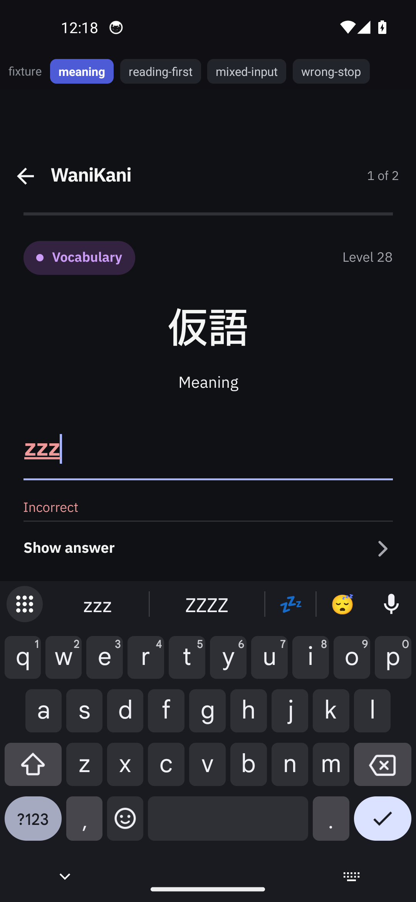
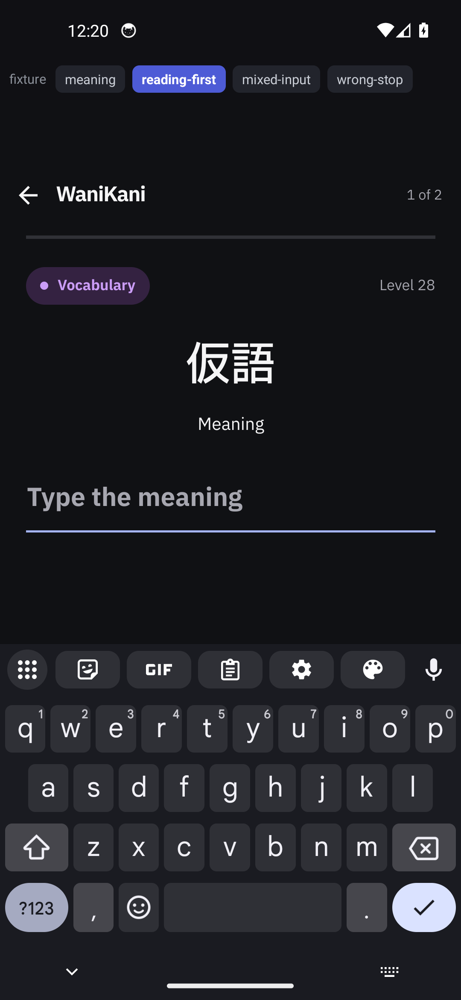
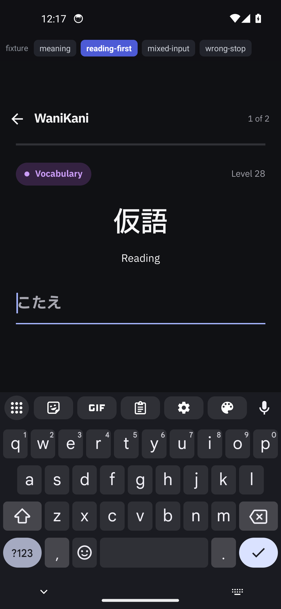
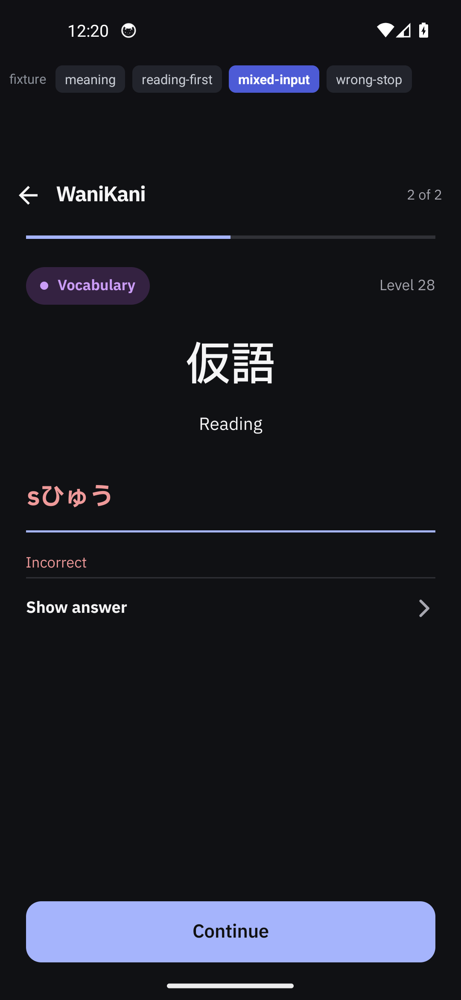
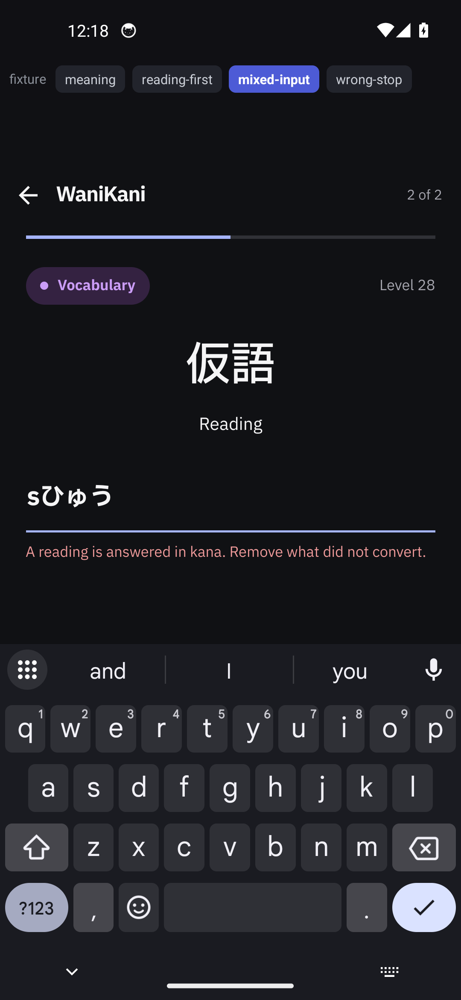
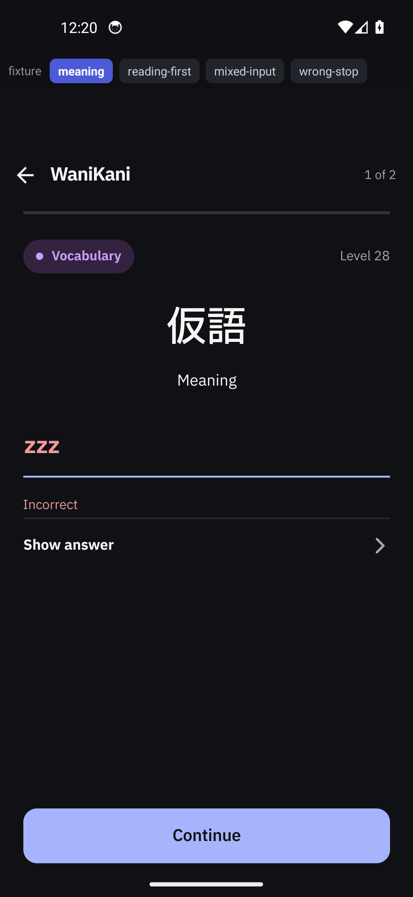
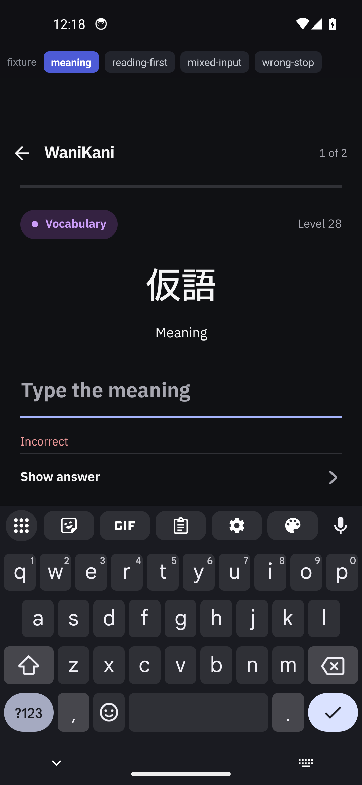
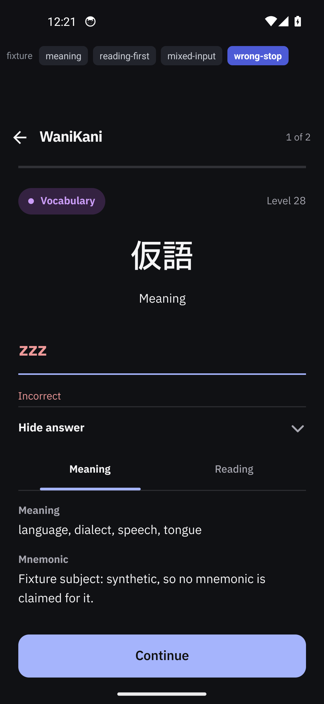
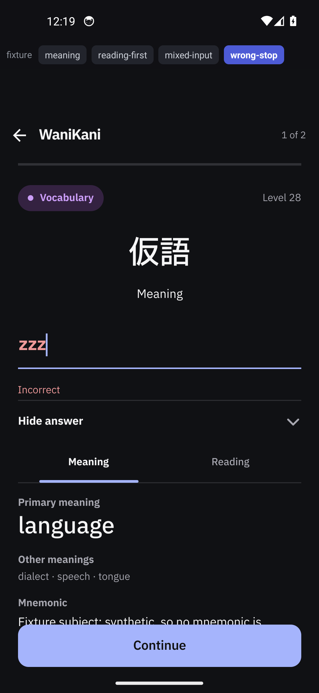

## Changes

Four review-flow fixes from TickTick checklist "wanikani hub feedbacka" (`6aed5bb289d8624dda312345`), all inside
`WaniKaniReview` and the review store it drives:

- **A pair's order is drawn, not fixed.** `buildWaniKaniPromptOrder(parts, random = Math.random)` now takes the
  draw, and after the existing gap repair every two-part subject has its pair turned round when its own drawn
  lead is the reading. The earlier minimum-5 / maximum-10 separation of a subject's meaning and reading is
  untouched: swapping a pair's two prompts moves neither closer to the other, so the spacing still holds and the
  reading is still 5–10 prompts from its own meaning. The draw is per subject and happens once, when the session
  starts, so a queue keeps its shape across re-renders; the default argument keeps the old signature working.
- **A reading answer that is not kana is refused, not judged.** `isKanaOnly` (two syllabaries, iteration marks,
  the prolonged sound mark) gates the store's reading judgement: an entry carrying anything else — a latin letter
  the converter could not finish, a digit, a kanji, punctuation — is not sent anywhere and counts nothing; the
  prompt keeps the field and shows "A reading is answered in kana. Remove what did not convert." until the next
  keystroke clears it.
- **A wrong answer keeps the keyboard.** The field is now editable whenever the session is not mid-submit-failure
  rather than only while answering or correct, so the wrong stop, the retry and the send all hold focus and the
  keyboard. The visible Done key runs the same Continue the footer does, so it arms the retry at a wrong stop and
  continues after it, and it never re-checks the same answer.
- **One primary meaning in the hero size.** The Meaning tab leads with WaniKani's primary meaning wearing the same
  hero lettering the primary reading does, and lists the remaining accepted meanings in the quiet small ink, so a
  word with a dozen meanings still reads as one answer.

The tests that cover this are extended in the same commit: the prompt-order suite drives the drawn order and the
kana refusal against the real store, and the romaji suite pins `isKanaOnly`.

## Visual evidence

- **UI changed:** Yes.
- **Screenshots:** All four requirements, before (`origin/dev`) and after, from the same emulator, the same build
  recipe and a byte-identical fixture harness. The headline still is the wrong-answer stop, which is where the
  keyboard defect was reported:

  

  

  
Requirement 1 — the pair's order is drawn (before, after)

  Before (`origin/dev`), the same pinned draw asks the meaning first:

  

  After, the same call asks the reading first:

  

  

  

  
Requirement 2 — a reading that is not kana is refused, not judged (before, after)

  Before, the same mixed entry is judged `Incorrect`:

  

  After, the same entry is refused and nothing is counted:

  

  

  

  
Requirement 3 — a wrong answer keeps the keyboard (before, after, and the retry)

  Before: the field is disabled and the keyboard is gone at the stop.

  

  After: the field holds the wrong answer with a caret and the keyboard is up.

  

  After the visible Done key: the field is cleared for the retry and the keyboard is still up.

  

  

  

  
Requirement 4 — one primary meaning in the hero size (before, after)

  Before, every accepted meaning in one size:

  

  After, the primary meaning large and the rest small:

  

  

- **Interaction, navigation or motion:** the wrong answer and its recovery as motion —
  [wk-visible-done-wrong-to-retry.mp4](wk-visible-done-wrong-to-retry.mp4). It is a fixture capture, as every
  asset here is, because the automation's Enter is not the reader's Enter: a synthetic `KEYCODE_ENTER` reaches
  `ReactEditText.onKeyUp`, which hides the keyboard for a single-line input, whereas the visible Done key goes
  through the editor-action listener, which is the path the reader actually uses. The interaction was therefore
  driven by tapping Gboard's on-screen Done key, and nothing was injected.
- **Source:** head `fix/wanikani-review-feedback` over `b8a4b40` (`origin/dev`); emulator `Gaten_Lookup_Review`
  (Android 14 x86_64, 1080×2340 @ 440, Gboard, test IME off), built with
  `ENTRY_FILE=.evidence-fixture/index.js ./gradlew --no-daemon :app:assembleDebug -PreactNativeArchitectures=x86_64`
  — the React Native Gradle plugin's own entry override, with `index.js`, `App.js` and `app/build.gradle.kts`
  untouched. Head harness APK sha256 `273ee4228dd72f815b369a3dc946b427da5e52aa793f4249414a9f4146bc6061` and baseline
  harness APK sha256 `09651a2154ff6c5b752ffbc8bd058a77e98835b2fe89e0cf7308087116fe7dfa`; each phase's on-device
  `base.apk` was verified against its artifact before capture. The captures exercise the review screen's four
  states and nothing else — not the queue read, the hub, the lesson quiz, the lookup overlay, or a real account.
- **Assets:** `docs/pr-evidence/wanikani-review-queue-and-meanings/` — this body's stills and clip, the harness as
  `fixture.patch`, and a README with the device, the build, both hashes, the isolation method, the guarantees and
  the limitations.

## Verification

- **Steps and result:** install the harness, open the fixture session, step through the four scenes, asserting on
  screen rather than by coordinate: the drawn lead (`.card` label), the refusal note's absence and then presence,
  the verdict, and the field's text. Requirement 3 was driven with the visible Done key: on the head it cleared the
  field, armed the retry and left the keyboard up; on the baseline no key exists at its stop — the field is
  disabled and the keyboard is gone — so nothing was injected there. Both phases' `base.apk` hashes matched their
  artifacts, and the bundled JS was proven rather than assumed: logcat shows `Failed to connect to /10.0.2.2:8089`
  → `isMetroRunning(): Async result = false` → `Loading JS Bundle`, with the cached dev bundle set aside.
- **Checks:** `tsc --noEmit` clean; `node --test tests/*.test.cjs` on the head = 156 tests, 112 pass, 44 fail, all
  44 inside `tests/wanikani-hub.test.cjs`, whose in-VM require map cannot load the review store — the same 68/24/44
  on `origin/dev`. Every other suite passes, including the three this change edits (`wanikani-review-prompt-order`
  9, `wanikani-romaji` 1, `wanikani-leave-confirm` 2). The production Android build and unit tests are left to CI.

## Problems

- Item 4 leads with one primary meaning: WaniKani can mark more than one, and the native decoder keeps the first.
  Carrying every primary through `WaniKaniReviewItem` would be a native change, deliberately not made here.
- Item 2 is scoped to the review screen, as the report's screenshot showed; the lesson quiz shares the converter
  and can still submit a non-kana reading.
- `tests/wanikani-hub.test.cjs` cannot run on this branch or on `origin/dev`: its in-VM require map cannot load the
  review store, so 44 of its 68 cases fail identically on both (68 tests / 24 pass / 44 fail). Not a regression
  from this change, and not fixed here.
- The evidence is synthetic by construction: the fixture bar is visible in every still, the harness reaches three
  private store members and fails closed on the two it overrides, and the AVD holds no WaniKani token, so nothing
  here proves a real account's behaviour.
- Account incident, disclosed: an earlier capture attempt on a real connected account submitted one review
  (the "Giant" radical, `incorrectMeaning: 1`), regressing that subject's stage, and a later fresh install wiped
  that AVD's stored WaniKani token, which its owner must reconnect. No capture from that session is used as
  evidence here.
