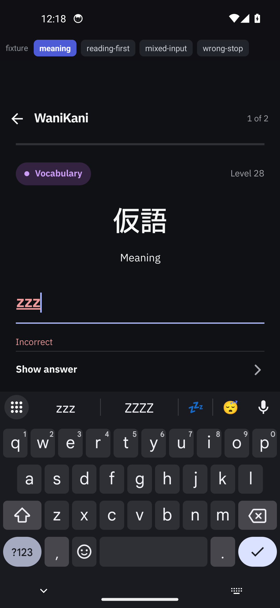

# WaniKani review feedback — evidence

Four review-flow requirements from TickTick checklist `6aed5bb289d8624dda312345`, captured before and after on
one emulator from a synthetic fixture build. No real account was involved in any capture: the queue is a
fixture session handed to the production store, and the only network-capable calls are stubbed out.

*After: a wrong answer stops with the field still editable and Gboard still up — the reported defect was that the
keyboard disappeared here.*

## The four requirements, before and after

| # | Requirement (checklist wording) | Before — `origin/dev` | After — this branch | What the pair shows |
| --- | --- | --- | --- | --- |
| 1 | "meaning card first and then the reading card, have it random" | `before-01-meaning-first.png` | `after-01-reading-first.png` | Same pinned draw of the pair's order: the baseline asks the meaning, this branch asks the **reading** |
| 2 | "reading should not be submitted if it contains invalid Japanese" | `before-02-mixed-judged.png` | `after-02-mixed-refused.png` | Same `sひゅう` in the field: the baseline **judges** it `Incorrect`, this branch **refuses** it and judges nothing |
| 3 | "after wrong answer we close keyboard, don't do that, let user type the enter button keyboard again consider that as continue" | `before-03-wrong-stop.png` | `after-03-wrong-stop.png`, `after-04-retry-armed.png`, `wk-visible-done-wrong-to-retry.mp4` | Baseline: field disabled and the **keyboard gone** at the stop; this branch: `zzz` red with the keyboard up, and Gboard's visible Done key clears the field and arms the retry — still no tap on the field |
| 4 | "1 or 2 primary meaning in big text just like reading section, and show the others in small text" | `before-04-meanings-flat.png` | `after-05-meanings-split.png` | Baseline: `language, dialect, speech, tongue` in one flat size; this branch: **language** at the hero size and `dialect · speech · tongue` in the small token |

All eight stills and the clip, with what each one shows

| File | Shows |
| --- | --- |
| `after-01-reading-first.png` | Head, the pair ordered by `buildWaniKaniPromptOrder([2], () => 0.1)`: prompt 1 is 仮語 **Reading**. |
| `before-01-meaning-first.png` | Baseline, the same call: prompt 1 is 仮語 **Meaning** (the baseline's builder takes no draw, so a meaning always leads). |
| `after-02-mixed-refused.png` | Head, reading prompt holding `sひゅう`: the short refusal note under the field, no verdict, nothing counted. The still carries the note's first wording ("A reading is answered in kana. Remove what did not convert."); the shipped string is now **"Invalid input — kana only."** |
| `before-02-mixed-judged.png` | Baseline, the same input: the entry judged `Incorrect`. |
| `after-03-wrong-stop.png` | Head, `zzz` judged wrong: red field with a caret, `Incorrect`, **keyboard up**, visible Done key present. |
| `after-04-retry-armed.png` | Head, after the visible Done key: field cleared, `Incorrect` still guiding the retry, keyboard still up. |
| `wk-visible-done-wrong-to-retry.mp4` | The same interaction as motion: type → visible Done → wrong stop → visible Done → retry armed. |
| `before-03-wrong-stop.png` | Baseline, `zzz` judged wrong: field disabled (no caret), **keyboard gone**, only the footer's Continue moves the reader on. |
| `before-04-meanings-flat.png` | Baseline, Meaning tab: every accepted meaning in one size. |
| `after-05-meanings-split.png` | Head, Meaning tab: `Primary meaning` **language** large, `Other meanings` `dialect · speech · tongue` small. |

## Why a fixture, and what it does

The automation's Enter is not the reader's Enter: a `KEYCODE_ENTER` key event reaches
`ReactEditText.onKeyUp`, which calls `hideSoftKeyboard()` for any single-line input, while the keyboard's visible
Done key goes through `ReactTextInputManager`'s editor-action listener, which dispatches the submit and returns
`true` without blurring. Photographing the real behaviour therefore needs the visible key — and no real account
may be touched, so the queue is a fixture.

The fixture mounts the **production** `WaniKaniReview` over the **production** review store and hands in one
synthetic session per scene:

| Real | Synthetic |
| --- | --- |
| `src/rn/ui/review/WaniKaniReview.tsx`, `review-store.ts` — entry, judgement, kana refusal, `meaningMatches`, phases, wrong counts, continue, the retry focus effect | the subject `仮語`, id `9001`, four meanings, one reading |
| `buildWaniKaniPromptOrder` (draws pinned, so a scene is the same queue every launch) | `onBack` / `onRetrySubmit` |
| the provider tree from `App.js` | the lookup overlay's registration |

Scenes, switched by a four-button bar that is part of the harness and visible in every still:
`meaning`, `reading-first`, `mixed-input` (entry seeded, the store judges it), `wrong-stop` (wrong answer judged).
The harness source is committed here as [`fixture.patch`](fixture.patch).

## Provenance

| Item | Value |
| --- | --- |
| Production diff | 6 files: `review-store.ts`, `WaniKaniReview.tsx`, `wanikani-romaji.ts`, `tests/wanikani-review-prompt-order.test.cjs`, `tests/wanikani-romaji.test.cjs`, `tests/wanikani-leave-confirm.test.cjs` |
| Base | `b8a4b40` (`origin/dev`) |
| Head harness APK | sha256 `273ee4228dd72f815b369a3dc946b427da5e52aa793f4249414a9f4146bc6061`, 205,486,508 B, bundle 2,695,848 B |
| Baseline harness APK | sha256 `09651a2154ff6c5b752ffbc8bd058a77e98835b2fe89e0cf7308087116fe7dfa`, 205,484,468 B, bundle 2,694,488 B |
| Harness source | `ReviewFixture.tsx` sha256 `a219fb95afc5be20fee03a9896ff863c3a683e2a23bff8cdb36279717bb62fb8` — byte-identical in both worktrees |
| Build | `ENTRY_FILE=.evidence-fixture/index.js ./gradlew --no-daemon :app:assembleDebug -PreactNativeArchitectures=x86_64` in each worktree; the entry override is the React Native Gradle plugin's own `ENTRY_FILE` precedence, so no production file changes |
| Device | `emulator-5556` = AVD `Gaten_Lookup_Review` (resolved by name), Android 14 x86_64, 1080×2340 @ 440, `font_scale` 1.0, system dark |
| IME | `com.google.android.inputmethod.latin` (Gboard), `show_ime_with_hard_keyboard 1`, opened with the test IME off |
| Install | `adb install -r <absolute path>` in both phases; the on-device `base.apk` sha256 was checked **before each phase's captures** and matched the artifact exactly in both |
| Bundled JS | proven, not assumed — logcat: `Failed to connect to /10.0.2.2:8089` → `isMetroRunning(): Async result = false` → `Loading JS Bundle`, after `debug_http_host` was pointed at the dead port 8090… (`8089`) and the cached `BridgelessReactNativeDevBundle.js` was set aside |
| Marker check | head bundle carries `Fixture subject: synthetic` and the head-only refusal string; baseline carries the subject and not the refusal string; both carry no production shell string |

### Restored after the lease

`debug_http_host` back to `10.0.2.2:8081` in both prefs files (from backed-up copies), the cached dev bundle
restored under its original name, app-data inventory identical to the pre-lease snapshot, IME and system settings
unchanged, the harness's agent-device session closed, emulator and shared daemon left running, and no other
workspace's device or session touched. The installed binary is left as the baseline harness artifact; the
pre-lease binary's hash was not recorded before the install, so it could not be restored.

## Guarantees

- **No account, no token, no network.** The fixture's whole surface is `getState`, `subscribe`, `startReviews`,
  `wkEntry`, `wkCheck`, `wkContinue`. The store's only network-capable calls — `submitReview` (via
  `submitWaniKani`) and `reviewQueue` (via `enterWaniKaniReview`) — are replaced with no-ops before the session
  is installed, and the install fails closed if either member has moved; the one native call still reachable,
  `readingAnswer`, is a local kana fold. The AVD holds no WaniKani token either.
- **No production build entry change:** `index.js`, `App.js` and `app/build.gradle.kts` are untouched.
- **Nothing was answered correctly**, so no subject's review could be completed even if a submit path existed.

## Limitations

- The fixture bar is visible in every still — deliberate, so a fixture capture cannot be mistaken for a real
  review of real content.
- The harness reaches three private store members (`pausedReview`, `submitWaniKani`, `enterWaniKaniReview`) and
  fails closed on the two it overrides; verified for these two artifacts, not guaranteed beyond them.
- One synthetic subject, two prompts: the captures prove nothing about the queue read, the hub, the lesson quiz,
  the lookup overlay, or a real account.
- `tests/wanikani-hub.test.cjs` cannot run on this branch or on `origin/dev` — its in-VM require map cannot load
  the review store, so 44 of its 68 cases fail identically on both (68 tests / 24 pass / 44 fail). Not a
  regression from this change.
- Item 4 leads with one primary meaning: WaniKani can mark more than one `primary` and the native decoder keeps
  the first. Carrying every primary through `WaniKaniReviewItem` would be a native change, deliberately not made.
- Item 2 is scoped to the review screen, as the report's screenshot showed; the lesson quiz shares the converter
  and can still submit a non-kana reading.
- **Account incident, disclosed.** An earlier capture attempt on a real connected account submitted one review
  (the "Giant" radical, `incorrectMeaning: 1`), regressing that subject's stage, and a later fresh install wiped
  that AVD's stored WaniKani token, which its owner must reconnect. No capture from that session is used as
  evidence; every still here is synthetic.
