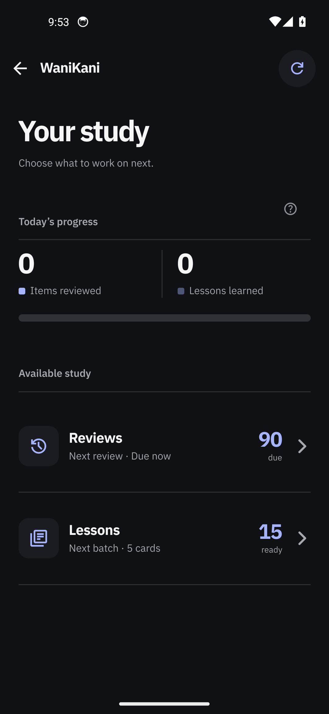
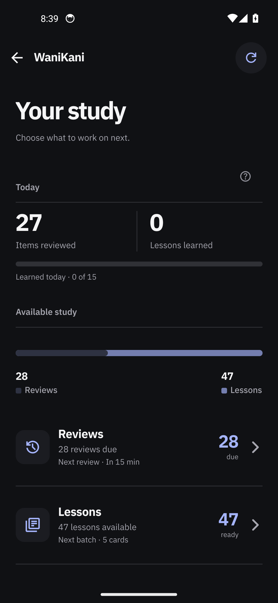
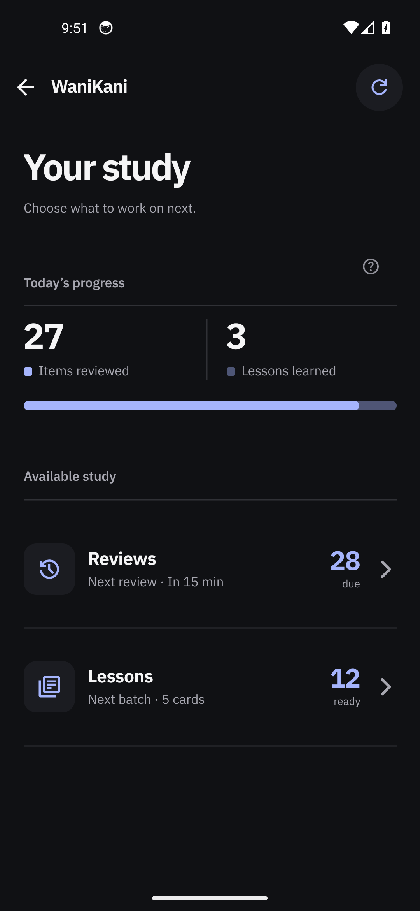
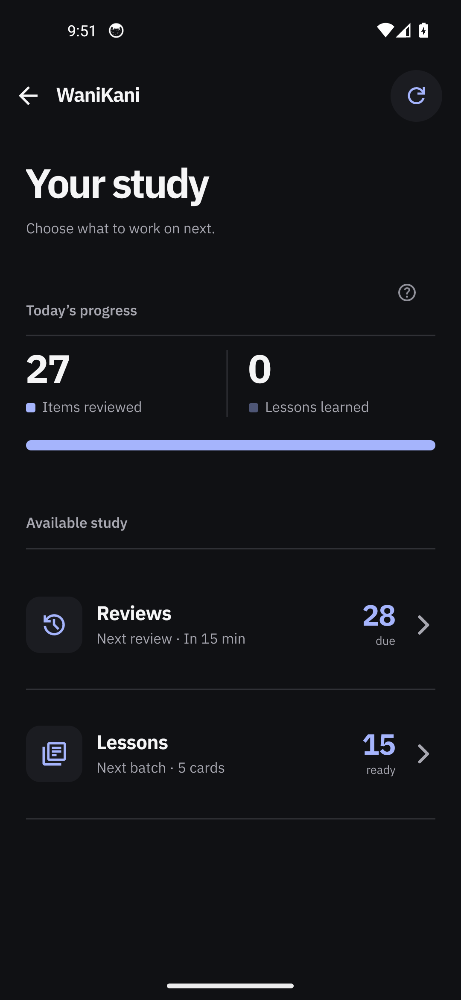
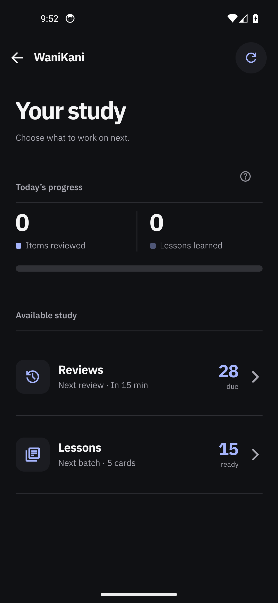
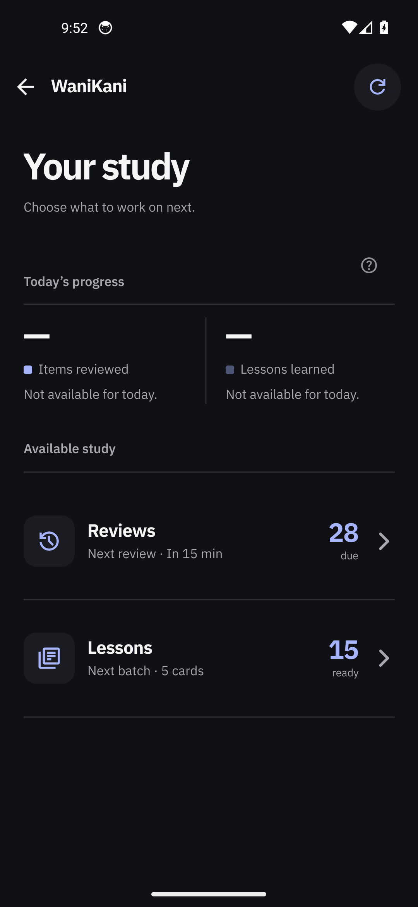
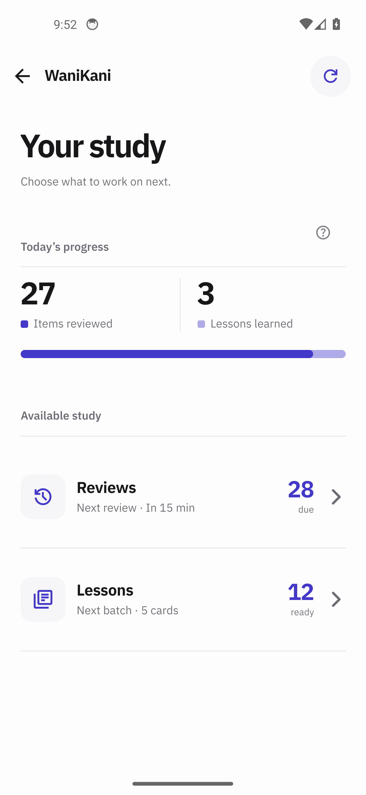
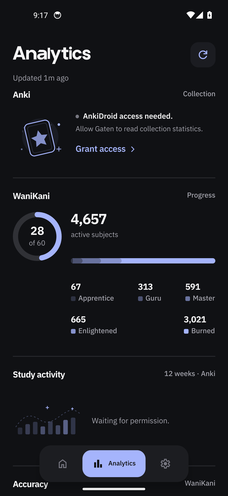

## Changes

The study page said the same two numbers three times: a `Today` row of two labelled bars, a legend
restating those counts, and then the two queue cards repeating them again. Its `Today` block also hid
itself whenever both counters were zero. This splits the page into two sections and removes the
repetition:

- **Today's progress** — the two device-local counts (`Items reviewed`, `Lessons learned`) each keep
  their caption and now lead with a small swatch in that segment's tone, over **one** segmented bar.
  No legend, no second row of numbers, no caption, no daily-goal line. A zero day draws the bar's
  neutral track; an unread count draws no bar at all. The bar is static: it takes no press target and
  speaks one accessibility sentence.
- **Available study** — the two queue cards keep the confirmed counts and carry the next review,
  batch or session state as their support line. The counts are stated once.

The Lessons count now obeys the daily lesson allowance instead of showing the whole unlocked queue.
`remainingDailyBudget = max(0, dailyLimit - learnedToday)`, then the trailing count is
`min(available, remainingDailyBudget)` when the limit is known, or the raw queue count when it is not.
The support line (`Next batch · N cards`) and the "Daily limit reached" state are unchanged. With 47
unlocked, a 15/day limit and nothing learned today the row reads **15 ready**; after 3 lessons it reads
**12 ready**; with only 3 unlocked it reads **3 ready**.

`ink.tsx` is shared with Analytics. `Metric`/`MetricPair` keep their original caption geometry when no
swatch is passed, and `StackedBar`'s `onSelect` became optional so the bar can render as a read-only
element without a hit layer.

## Visual evidence

Real app on the connected test account — the Lessons row now reads 15 ready for a 15/day limit:

The study page arrives with a short transition; this clip shows navigation into it on the new design.

https://github.com/Anurag-Raut/Gaten/blob/<COMMITTED_SHA>/docs/pr-evidence/wanikani-study-progress/14-after-study-open.mp4

Before and after, the zero and unknown states, the light theme, and the Analytics regression pair

### Before — the old design, same page

### After — synthetic scenes that the real account cannot reach today

The real account has no in-app activity today, so the populated bar and the mid-day allowance can only
be shown by the inert fixture harness. These render the production component tree with injected state;
the numbers are chosen by the fixture rather than fetched.

### Analytics regression — the shared `Metric` change must not move

Same screen, pre-change build versus this build: 220 of 2 397 600 pixels differ (0.009%), all inside
the "Updated _m ago" relative-timestamp glyph. Every metric block is pixel-identical.

## Verification

- **Steps and result:** installed each build on one emulator (`Gaten_Lookup_Review`, API 34, x86_64,
  1080×2340), launched the fixture scenes with `am start … --es settings_page <scene>` and the real app
  from its Home card, and captured the stills above. The Lessons row reads 15 ready at 0 learned and 12
  ready at 3 learned on the fixtures, and 15 ready on the real account; the real app's accessibility
  label reads `Lessons, 15 ready, next batch 5 cards`.
- **Checks:** `tsc --noEmit` exit 0. `node --test tests/wanikani-hub.test.cjs` on Node v24.19.0 gives
  **68 tests, 24 pass, 44 fail**, identical to the base commit — same counts, byte-identical failing
  names, single pre-existing cause (`Unexpected import: ./wanikani-romaji`). Gradle `:app:assembleDebug`
  succeeded for all five APKs. Analytics regression measured as above.
- **Assets:** `docs/pr-evidence/wanikani-study-progress/` — stills, clip, README with base commit,
  source hashes and per-APK/bundle hashes, plus `fixture-injection.patch` holding the harness-only
  change that is not part of the production commit.
- **Blocked capture:** the connected test account has no in-app activity today, so the real-app still
  shows the zero state of the progress block and the populated bar appears only in the synthetic stills,
  which the body labels as such. The clip therefore shows navigation and arrival, not a bar filling in.
  The light theme is covered by synthetic stills only.

## Problems

- The fixture harness crashed on first use because the shared chart primitives call `useIsFocused()` and
  the harness had no navigation context. Fixed in the harness only, by wrapping its root in a
  `NavigationContainer`; the app always renders inside a navigator. Documented in the patch, not shipped.
- Two APK sets are kept: the production pair (`before-production.apk` /
  `after-production.apk`, `after-production.apk` = `fb8cb83539c29abd055116dcedf2b410782fd81b183c44a208e176e095f4b2ab`)
  and the fixture pair used for the synthetic stills. The README lists every hash.
