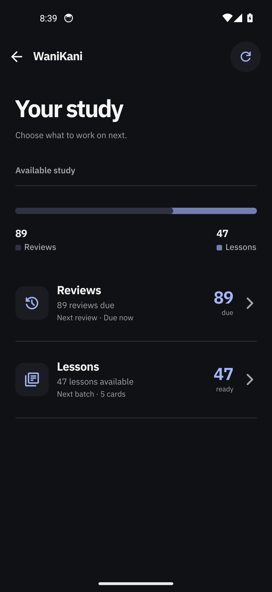
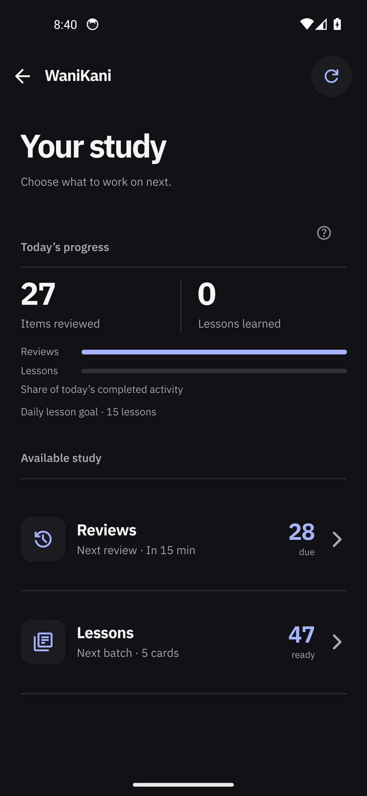
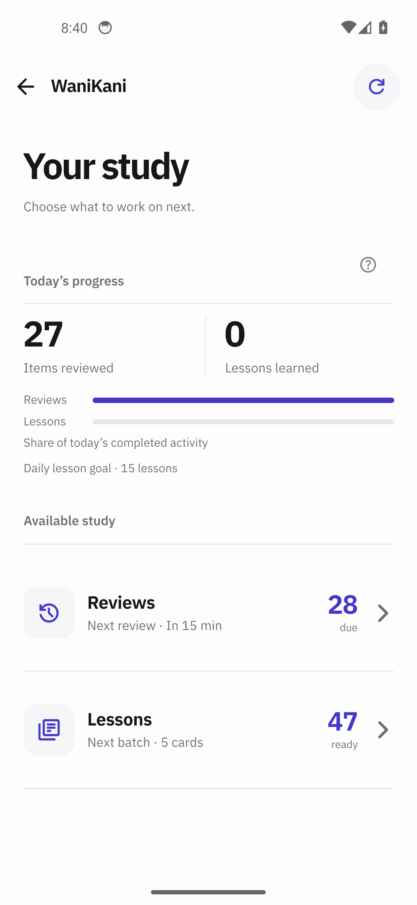
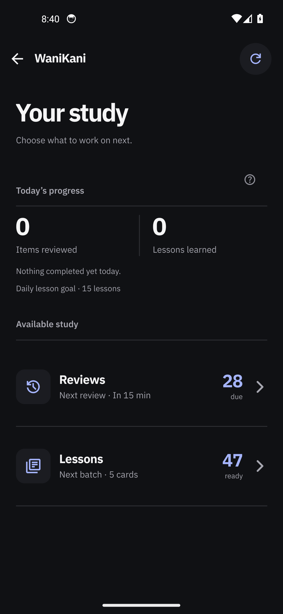
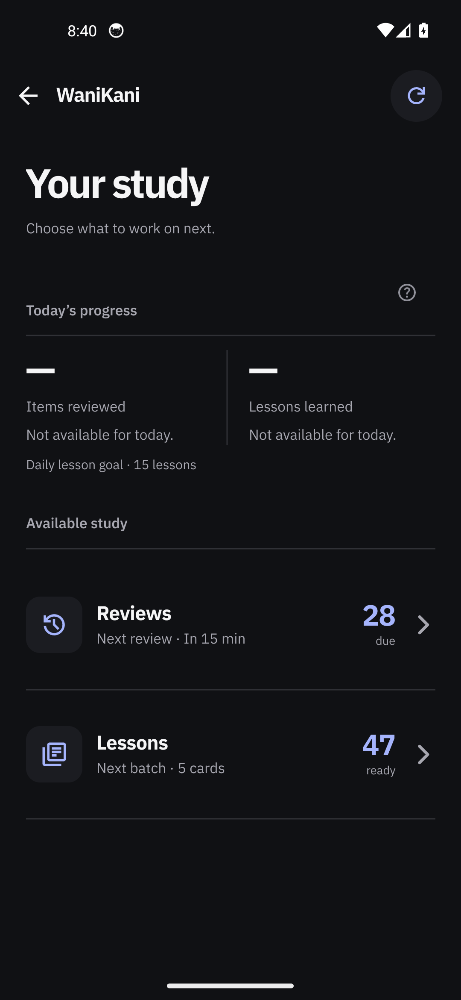

## Changes

The WaniKani study page said the same two numbers three times. Its `Today` block hid itself whenever
both counters were zero, and its `Available study` block drew a distribution bar with a legend
("28 Reviews · 47 Lessons") directly above two cards that each already showed the same count
("28 due", "47 ready"). The page is now two sections that each say one thing.

- **Today's progress** (`src/rn/ui/review/WaniKaniHome.tsx`) — the two device-local counts (Items
  reviewed / Lessons learned) with a horizontal chart of the day's own mix: two labelled bars whose
  shares run against today's completed total, captioned "Share of today's completed activity", then
  the daily lesson goal as a single line. The section always renders now: a confirmed 0/0 says
  "Nothing completed yet today." instead of the block disappearing, and an unread figure keeps its
  dash and its reason with no bars drawn.
- **Available study** — the two queue cards alone, Reviews then Lessons, each carrying its own count.
  The distribution bar and its legend are gone, so each count appears once.
- `src/rn/ui/review/wanikani-hub-model.ts` — the cards' support lines no longer restate the count the
  card already shows.
- `tests/wanikani-hub.test.cjs` — existing expectations pinned to the removed duplicate copy
  updated; no new tests.

Accessibility: the chart's nonzero label speaks percentage shares
(`"${reviewedPercent}% reviews and ${learnedPercent}% lessons of today's completed activity."`, one
rounding plus its complement) so it does not repeat the counts the metric pair already speaks.

## Visual evidence

- **UI changed:** Yes.
- **Screenshots:** Below. Real app, production bundle, connected test account — before, where both
  counts appear twice and no `Today` section exists at all:

  

  Real app, production bundle, same account — after, `Today's progress` present and each card
  carrying its count once:

  

  The reported state (27 items reviewed / 0 lessons learned today, 28 reviews / 47 lessons), before
  and after, rendered from synthetic hub state because a live account cannot show 27 completed
  reviews without submitting real ones:

  

  

  Light theme, after:

  

  Zero and unknown, after — the two states this change separates:

  

  

- **Interaction, navigation or motion:** [Screen recording of the page opening from Home on the real
  app](https://github.com/Anurag-Raut/Gaten/blob/<COMMITTED_SHA>/docs/pr-evidence/wanikani-study-progress/10-real-after-study-open.mp4)
  — 5.7 s, 1080 × 2340. The old bar's tap-to-select legend is removed along with the bar itself.
- **Source:** head commit `<COMMITTED_SHA>` on `feat/wanikani-study-progress`, based on `dev`
  `9350181`. Captured before the commit, so the head under test is the working-tree diff
  `776076f72f28a85a371737da587a4f179a5a57ccf7184ce538992c7003d410e2` of `9350181` (3 files,
  +164/−152) — the same three files named in Changes. Device: Android emulator `emulator-5554`, AVD
  `Gaten_Lookup_Review`, Android 14 (API 34), 1080 × 2340 @ 440 dpi, dark theme, system font scale
  0.94. Build: `flock /tmp/gaten-build.lock ./gradlew :app:assembleDebug
  -PreactNativeArchitectures=x86_64 --max-workers=2`, debug variant with the JS bundle embedded (no
  Metro). APK installed for the after captures, sha256
  `06668b2dc2d7b4a91b0d9ef42660afd1f68ad03dea03eb6544862e4cb19787a4`; before captures used
  `56f93104630ecb0e6f4a785f5248dea185f5cf13aab95909aa1876f2870b267e`; the synthetic captures used
  `ea54df17c6f9c879f96685142e0fa327a29ffea4a60c93aa83e9dd6b5ddd715d` (after) and
  `c06db074d2e916e90a395431c05b98ca7a8b9fc5295721e44192cb8d6d558eec` (before). Every APK's sha256
  and its embedded-bundle sha256 are in `docs/pr-evidence/wanikani-study-progress/README.md`.
  Not exercised: large system font scales, TalkBack, landscape, and the light theme on a real
  account.
- **Assets:** `docs/pr-evidence/wanikani-study-progress/` — README, ten captures, and
  `fixture-injection.patch`. The patch documents the synthetic-scene injection used only inside the
  throwaway build worktree; it is not production code.
- **Blocked capture:** None. The test account had no completed items today, so the real-app still is
  the zero state and the bar chart appears only in the labelled synthetic stills.

## Verification

- **Steps and result:** Built and installed the base and head bundles on the emulator and opened the
  WaniKani study page from Home on the connected account, before and after, capturing stills plus a
  recording; the reported 27/0 state, the zero state and the unknown state were then captured from
  synthetic hub state in the same component, in both themes.
- **Checks:** `node --test tests/wanikani-hub.test.cjs` on Node v24.19.0 — `tests 68, pass 24,
  fail 44`, **identical on the pristine base `9350181` and on the head**, with a byte-identical set
  of 44 failing test names and one pre-existing cause: `Error: Unexpected import: ./wanikani-romaji`
  raised by the test file's own TypeScript loader. No regression is attributable to this change.
  `tsc --noEmit` exits 0 on the head. `./gradlew :app:assembleDebug
  -PreactNativeArchitectures=x86_64` is BUILD SUCCESSFUL for base and head, and the installed
  `base.apk` hash was confirmed on-device with `sha256sum` before and after capture.

## Problems

- The 44 `wanikani-hub.test.cjs` failures are a pre-existing harness defect (the test's inline TS
  loader cannot resolve `./wanikani-romaji`), present identically at the base commit and out of scope
  here.
- The real-app still is the zero state because the test account has no in-app activity today; the
  non-zero chart is evidenced only by the synthetic stills, which the body labels as such.
